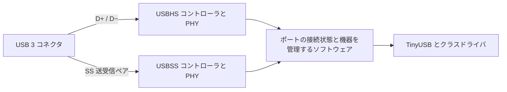

# CH32H417 の TinyUSB SuperSpeed 対応に向けた事前調査

調査日: 2026-10-16。実装前の設計検討であり、対応済み機能を示すものではない。

対象は 5 Gbit/s の SS。10 Gbit/s 以上の SuperSpeedPlus は初期実装の対象外とする。DCD は Device Controller Driver、HCD は Host Controller Driver、BSP はボード側の初期化・接続部分を指す。

## 結論

**TinyUSB を拡張して CH32H417 の USB SuperSpeed を使うことは現実的である。ただし、既存 HS ドライバへの小さなパッチだけでは足りない。** 共通スタック、クラスドライバ、SS 用コントローラドライバ、この Arduino コアの速度別 descriptor 生成に変更が必要になる。

調査時点では、上流 master と本リポジトリの固定版には SS 対応がない。一方、次の未マージ PR がすでにある。

- [TinyUSB PR #3779](https://github.com/hathach/tinyusb/pull/3779): メンテナ hathach による汎用 SS Device 対応と CH569 / CH32H417 のポート。共通層を SS 対応にし、コントローラ依存を DCD と BSP に分離する方向。
- [TinyUSB PR #3782](https://github.com/hathach/tinyusb/pull/3782): rhgndf による CH32H417 USB3 対応。Endpoint Companion を DCD まで渡す API と endpoint ごとの burst 設定がある。USB2 接続への対応は未実装と明記されている。

**推奨は、両 PR の統合方針に合わせて必要部分を検証・補完し、SS 共通機能として上流へ還元すること。** 第三の独立した「CH32H417 専用 SS スタック」を作る理由は薄い。先に固定 commit の評価用ブランチで Device の control / bulk / interrupt を確かめ、上流に残す共通差分と Arduino 固有の接続処理を分ける。SS Host、ISO クラスの完成、最大性能の追求は別段階にする。

ここでいう USB2 接続への対応は、**USB 3 ポートに HS 機器を接続すると USB 2 側で HS 通信する通常の互換動作**である。SWD の使用とは別の話であり、SWD が速度切替を起こすわけではない。

## 調査対象と再現用の版

| 対象 | 読み取った版と状態 |
|---|---|
| ArduinoCore-CH32RV | `980e1ff30bd45c603e9c7e584ecb164f511306c2`。調査開始時の作業ツリーに変更なし |
| 同梱 TinyUSB | `de4940525876259efb17f14e775312365bfdf97c`。正本は [tinyusb.lock.toml](../vendor/tinyusb.lock.toml) |
| TinyUSB master | `ea1d867ced5259d49679f481e5d4e21a36dc11b0`。2026-10-16 取得時点で `src/` に SS の速度定義・DCD はない |
| PR #3779 head | `35cd5e47520e84e15cd80f7a2aee1c383f9c6b9a`。Open、未マージ。API 上の変更は 141 files、うち `src/` は 28 files |
| PR #3782 head | `a262c7b009dc84ab0ba3f43461526ce580976323`。Open、未マージ。API 上の変更は 94 files、うち `src/` は 55 files |
| 手元のベンダー資料 | `~/dev_wch/CH32H417`、commit `0186b6b70350922ec0005a11311fcba7ec3169d7` |
| PDF | 英語 DS V1.9、英語 RM V1.8、Evaluation Board Reference V1.5。EVT の USBSS サンプルも参照 |
| USB 規格 | USB-IF の USB 3.2 Revision 1.1、June 2022、主に第 8 / 9 / 10 章 |

本調査ではソースと資料を確認した。自前のビルド、実機列挙、転送試験は行っていない。以下の上流の実測値・不具合報告はその報告者の結果であり、この Arduino コアで再現した結果ではない。PR の状態と API は取り込み時に再確認する。

## USB 3 ポートと CH32H417 のハードウェア

### SS と HS の関係

CH32H417 は USBSS、USBHS、USBFS を別のペリフェラルとして持つ。USBSS は PHY 内蔵の 5 Gbit/s、USB 3.2 Gen 1 相当。RM 第 27 章には独自の LINK、Device、Host レジスタがあり、USBHS の速度設定を変更して SS にする構造ではない。SS の制御、bulk、interrupt、isochronous、burst、DMA、U1/U2/U3 をハードウェアとして備える。[W1], [W2]

USB 3 コネクタには USB 2 用の D+/D− と SS 用の送受信差動ペアがある。評価ボード資料も USBHS/USBSS の共用インターフェースとして説明している。[W3]

| CH32H417 の役割 | 接続相手 | 通信経路と実装上の意味 |
|---|---|---|
| Host | HS Device | USB 3 ポートの USB 2 側で HS。USBHS HCD が必要。相手に SS リンクを要求しない |
| Host | SS Device | SS の接続が成立すれば USBSS HCD で通信する |
| Device | USB 2 Host、または USB 2 のみのケーブル経路 | USBHS DCD で HS/FS を扱い、その速度の descriptor を返す |
| Device | SS 対応 Host と SS 配線 | SS の接続が成立すれば USBSS DCD と SS descriptor を使う |

ユーザーから見れば「USB 3 ポートで HS 機器も使える」。内部では USBSS の PHY が 480 Mbit/s に変わるのではなく、USB 2 側の経路を使う。WCH の `USBSS/HOST/Host_SS_Access_Sector/Common/hardware.c` も USBHS の接続フラグを見て、`USB_U20_SPEED` と `USB_U30_SPEED` で列挙処理を分けている。[W4]

PR #3779 の `CFG_TUD_WCH_USB30_FALLBACK` は **Device 側で USBSS と USBHS を同じ論理 rhport に収める実装の設定名**である。USB 3 ポートの互換性一般や Host の HS Device 接続と同義には扱わない。また、接続中の bulk 転送をそのまま別速度へ移す機能でもない。切断・reset・再列挙を含む接続管理である。[T3], [U1]

### SWD と競合するのは USBHS の端子

DS の端子表では PB8 が `SWCLK / USBHS_DP`、PB9 が `SWDIO/SWIO / USBHS_DM`。SWD/SDI と USBHS を同時に使うことに制約があり、SS 差動ペアそのものとは別である。**SWD を使っているため HS 側を使えないことと、USB 3 ポートが HS 機器に対応することを区別する。** [W1]

したがって、SS 単独の動作確認、通常の USB 3 ポートとしての HS/SS 互換動作、HS 接続中のデバッグは別々に試験する。HS 接続中の観測には UART ログ等を用意する。#3779 の nanoCH32H417 BSP が USB2 接続処理を既定で無効にしているのはその開発環境の制約を反映したもので、CH32H417 の USB 3 ポートが HS 機器に対応できないという意味ではない。[T4]

### ドライバ設計に関係する特性

- RM には endpoint 1～7 の IN/OUT レジスタと、endpoint の複数 CHAIN による DMA がある。両 PR も `EP_MAX=8` とし EP0～7 を扱う。enable レジスタのビット幅や EVT の `DEF_UEP_NUM=16` だけから使用可能数を決めない。[W2], [T3], [T5]
- PHY、PLL、LTSSM に関する LINK 割り込み、hot/warm reset、ERDY/NRDY、sequence、STALL、CHAIN 完了を DCD で扱う。既存 `dcd_ch32_usbhs.c` のレジスタアドレス置換だけでは実装できない。[W2], [T3]
- DMA バッファは到達可能な SRAM と整列条件を満たす必要がある。#3779 の BSP は V3F 上で動作し shared SRAM を使う。V5F の DTCM 配置などへ無条件に一般化しない。DS の CPU cache 記述は instruction cache であり、一般的な Cortex-M7 の D-cache 対策をそのまま前提にしない。[W1], [T3], [T4]
- ベンダーの CH372Device サンプルは SS の 1024-byte packet、16-packet burst、USBHS との接続処理を読む材料になる。ただし descriptor 値や待ち時間を製品向けにそのままコピーする根拠にはしない。[W4]

## TinyUSB 共通層に必要な SS 対応

これは CH32H417 固有の処理ではなく、他の SS コントローラも利用する層である。表の API 名は現行 PR のもの、実装方針は本調査の提案。

| 項目 | 必要な変更と注意点 |
|---|---|
| 速度と capability | `TUSB_SPEED_SUPER`、`OPT_MODE_SUPER_SPEED`、`TUD_OPT_SUPER_SPEED` 等。ビルド時の最大能力と、`tud_speed_get()` が返す実接続速度を分ける。既存 FS/HS の値と既定を維持する |
| EP0 | SS の最大 packet は 512 bytes。Device descriptor の `bMaxPacketSize0` はバイト数ではなく指数の **9**。同じ SS 対応バイナリを USB2 で使う際には EP0 packet と descriptor を 64 bytes 等の USB2 の値に戻す。バッファ容量を 512 にするだけでは不十分 |
| bulk と validation | SS bulk の `wMaxPacketSize` は 1024。`TUD_EPSIZE_BULK_MAX`、`tu_edpt_validate()`、class endpoint buffer と速度分岐を更新する。HID 等の interrupt packet を一律 1024 にする必要はない |
| Endpoint Companion | EP0 を除く各 endpoint descriptor の直後に 6-byte SS Endpoint Companion を置く。構成全長、クラスの読み進め位置、driver が消費した長さを更新する。SS でない接続には付けない |
| Companion の意味 | `bMaxBurst` は 0～15 で、実 packet 数は +1。bulk の `MaxStreams`、ISO の `Mult`、periodic endpoint の `wBytesPerInterval` を endpoint の能力として扱う。descriptor を skip するだけでは DCD は設定値を得られない |
| BOS | SS USB Device Capability、USB2 Extension 等を実装能力に合わせて構成する。既存 WebUSB / Microsoft OS 2.0 Platform Capability と合成し、長さ・件数を計算する。USB2 LPM、LTM、SSP を未実装なのに宣言しない |
| その他の descriptor | SS 用の `bcdUSB`、SS では 8 mA 単位となる `bMaxPower`、速度別 interval を扱う。Device Qualifier / Other Speed Configuration は USB2 内の FS/HS 用であり、SS↔HS の descriptor 取得手段に転用しない |
| 標準 request | `SET_SEL` の 6-byte OUT、`SET_ISOCH_DELAY`、U1/U2 enable と `GET_STATUS`、interface の `FUNCTION_SUSPEND` / remote wake を整合させる。request の方向・長さ・状態と、接続速度を検証する |
| DCD との契約 | packet 転送に加え、Companion 情報と必要な link power / latency 設定を渡せる経路を決める。汎用 request を WCH レジスタへ直接結び付けない |
| 非 SS ビルド | SS 専用の状態、512-byte EP0、追加 descriptor を FS-only MCU に無条件に増やさない。FS-only、HS-capable、SS-capable の各ビルドを検証する |

規格上の根拠は USB 3.2 第 8 章、§9.2.6.6、§9.4.5 / 9.4.9 / 9.4.11 / 9.4.12、§9.6.1～9.6.3、§9.6.6～9.6.7。現行コードの不足は固定版の `tusb_types.h`、`tusb_option.h`、`tusb.c`、`device/usbd.c` と両 PR の差分でも確認できる。[U1], [T1], [T2], [T6]

### DCD に Companion を渡す API が重要

#3779 は `dcd_edpt_open(rhport, desc_ep)` を維持し、H417 DCD の burst は `CFG_TUD_WCH_USB30_MAX_BURST` に依存する。一方 #3782 は `dcd_edpt_open(rhport, desc_ep, desc_end)` とし、境界付き descriptor 列から endpoint ごとの `bMaxBurst` を取得する。#3782 の変更ファイルが多い理由の一つは、既存 DCD の呼出規約をそろえる変更である。[T3], [T5], [T6]

**汎用化には「各 endpoint の Companion が、安全に DCD まで届く」という契約が必要。** 上流で #3782 の境界付き API を採るか、共通層で解析した設定を別 API へ渡すかを合意する。特定 MCU 名の `#if` や WCH 固有の global burst 設定を共通クラスに持ち込まない。追加 API 案を独断で第三系統として広げず、既存 PR を基準に調整する。

境界付き API を採る場合も、descriptor 全体の長さ、Companion の最小長、type、burst 範囲、転送種別との組合せを検証する責務を明確にする。単に `desc_end` を引数へ足すことと、入力検証が完了することは別である。

最初の bulk PoC は `bMaxBurst=0`、`MaxStreams=0` でよい。これは SS の 1-packet burst であり、速度を HS に落とす設定ではない。16-packet burst と streams は別機能で、streams を使わずに burst を増やせる。既存 DCD の `uint16_t` 転送長でも 16×1024 bytes は表現できるため、SS の第一段階で全 API を 32-bit 化する必然性はない。

### クラスドライバの範囲

CDC、MSC BOT、Vendor、HID などは上位プロトコルを維持しつつ、packet/buffer、descriptor と解析を SS 対応にする方向が取れる。MSC の sector size 512 bytes と USB packet size 1024 bytes は別概念であり、sector size を 1024 に変更して解決するものではない。

Audio / Video / BTH の ISO は別の難所になる。SS の service interval、ITP、burst / Mult、時刻・feedback の扱いまで必要である。#3779 の H417 DCD は ISO モードの endpoint を開けるが、`dcd_sof_enable()` は no-op。**ISO endpoint を扱えることと、TinyUSB の Audio/Video クラスが正しく動くことは同じではない。** 同 PR の説明でも ISO クラス例の完成は対象外。#3782 の UAC2 例の変更も、全 ISO 機能の実機保証とは読まない。[T3], [T5], [P1], [P2]

## 既存 PR を採用する場合の評価

| 観点 | #3779 | #3782 |
|---|---|---|
| 汎用 SS 層 | 型、設定、EP0、BOS/descriptor template、多数のクラス、標準 request、unit test | 型、設定、descriptor、クラス、標準 request、DCD API の拡張 |
| 対象 hardware | CH569 と CH32H417 | CH32H417 |
| endpoint 設定 | DCD API は従来型。H417 burst はビルド設定 | 境界付き descriptor を DCD へ渡し、endpoint ごとに burst を読む |
| USB2 接続 | 同じ rhport の USBHS DCD への切替実装あり。H417 BSP では既定無効。再接続等に未解決点 | PR 説明で未実装 |
| Host | SS Host の完成実装ではない | Host 側の速度定義等はあるが、SS HCD や列挙・hub の完成実装ではない |
| 採用判断 | 共通層・試験・複数コントローラ対応の参考に適する | endpoint API と burst の参考に適する |

メンテナは #3779 の 2026-07-24 のコメントで、両 SS PR を統合して最初の SS 対応を入れる意向を示している。ただし調査時点で両方とも Open であり、採用 API、マージ時期、現状の品質を確約する発言ではない。[P1]

両者は同じファイルを異なる形で変更している。#3779 の古い tree を同梱版に丸ごと上書きすると、その後の FS/HS 修正や既存 CH32 ポートを巻き戻す。**最新の採用基準 commit に必要差分を載せ直すか、上流で統合された commit を取り込む。二つの PR を機械的に cherry-pick して完成とは扱わない。**

### 取り込み前に解消または範囲を限定する項目

次は #3779 の固定 head にある開発文書・コードの内容と、本調査での評価を区別した一覧である。開発文書にある推定 silicon 制約を、WCH の正式な errata として扱わない。[T3], [T7]

| 項目 | 上流にある記録またはコード | 採用に向けた扱い |
|---|---|---|
| USB2 への再接続 | CH569 で SS 接続後に USB2-only ポートへ移すと列挙しない再現報告。H417 にも似た終端状態が残るとの記載 | VBUS/接続検出、抜去、電源維持中の再挿入を含む状態遷移を検証。SWD 競合とは別のソフトウェア課題 |
| clear-stall と abort | 転送再開すべき clear-halt と、Vendor の中断に使う stall/clear が DCD から区別できないとの記録 | API の意味を整理してから変更。個別 MCU の応急処置だけで終えない |
| 小さい OUT バッファ | H417 の受信 CHAIN は packet 単位で DMA。#3779 は short buffer 用に bounce buffer を持つ | MSC CBW 31 bytes 等に対する 1024-byte 受信でメモリを壊さないことを確認。#3782 の直接 DMA 経路にも同じ監査が必要 |
| warm reset | LINK ISR 内に約 30 ms の待機と再初期化が残るとの記録 | Arduino の割り込み遅延と整合させる。handshake と遅延処理の順序を実機で検証する |
| 回帰試験 | SS 有効設定に unit test が偏るとの記録 | SS 無効ビルドでも同じ制御・解析試験を動かす |
| ISO と時刻 | H417 の SOF 通知経路が未整備 | 初期対応クラスから ISO を除外し、API が黙って成功しないようにする |

#3782 も完成品としては扱わない。固定 head の `SET_SEL` は SS と長さの検査、`SET_ISOCH_DELAY` は SS の検査にとどまり、#3779 にある方向等の検査とは異なる。Companion の範囲検査、short OUT、EP0 の複数 packet、link power の設定反映を両 PR の良い部分でそろえる必要がある。[T5], [T6]

`SET_SEL` を ACK することと、その latency 情報をコントローラの省電力処理に正しく反映することも別である。#3779 は共通層で受信するが、汎用の power management 完成を保証するものではない。他コントローラへ展開するときはデータと状態の受渡しも契約に含める。

### 性能値の読み方

WCH DS の 450 MB/s はベンダーの測定値。#3779 本文は bulk 約 72 MB/s、MSC read 約 200 MB/s、#3782 本文は `cdc_msc_throughput` 320 MB/s、Vendor は別変更 #3180 による memcpy 除去後 400 MB/s と報告する。ホスト、転送方向、buffer、クラス、コピー条件が異なり、直接の優劣比較にも Arduino の保証値にも使えない。[W1], [P1], [P2]

まず列挙とデータ完全性を成立させ、その後に burst、複数 CHAIN、転送の再投入頻度、コピー回数を測る。SS は 5 Gbit/s のリンクであり、`Stream::write()` を少量ずつ呼ぶアプリケーションが自動的に数百 MB/s になるわけではない。

## ArduinoCore-CH32RV に必要な変更

上流 SS 対応を取り込んでも、このコアの対応は完了しない。現在の `tusb_config.h` には H417 Device/Host を有効にする分岐がなく、USB ライブラリ側は未対応になる。既存 HS 経路も主に V30x 向けである。[A1]

| 場所 | 現状 | 改修案 |
|---|---|---|
| `CH32RVTinyUSB/src/tusb_config.h` | EP0=64、CDC endpoint buffer は FS/HS の二択、H417 無効 | H417 capability と SS 用設定を追加。SS-capable build の EP0 と class buffer を適切に確保 |
| `CH32RVUsbDevice.cpp` | `buildConfiguration(..., bool hs, ...)`、`running_high_speed()`、`bcdUSB` は USB2 系 | FS/HS/SS の実速度で descriptor を生成。SS の EP0 指数、構成全長、電力単位を反映 |
| `CH32RVUsbDeviceInternal.h` と各 function | `hs ? 512 : 64`、descriptor callback に `bool highSpeed` | 内部速度型を enum に拡張し、各クラスで SS template と Companion を使う。公開 callback 変更には移行策を用意 |
| `CH32RVUsbDevicePlatform.cpp` | BOS は WebUSB / MS OS 用の固定容量 `5+24+28` | SS capability と既存 Platform Capability を合成。Vendor/DFU を宣言しない SS 構成にも BOS を提供 |
| `CH32RVUsbDevicePort.h`、DCD glue | コントローラ選択と `port_high_speed()` が中心 | コントローラの能力、接続中の速度、USBHS/USBSS が共用する物理ポートを別の情報として保持 |
| 独自 CCID 等 | `usbd_edpt_open()` を直接呼ぶ箇所がある | 上流 API の変更に追従し、Companion を含む長さを正しく処理 |
| 起動・IRQ・clock・memory | このコアが所有する設計 | H417 の USBSS/USBSS_LINK/USBHS IRQ、PLL/PHY、DMA SRAM を既存生成物・所有権に合わせる。上流 BSP の startup を丸ごと置換しない |
| task と timer | Arduino の `ch32rv_usb_task()` 等から進める | SS の再投入頻度を測り、長時間の busy wait を避ける。#3779 が使う TIM12 を無断で占有せず timer 所有権に組み込む |

根拠となるローカルコードは [A1]～[A4]、起動処理と timer の原則は [ADR-0003](adr/0003-owned-startup-vector-linker.ja.md) と [timer-design.ja.md](timer-design.ja.md)。上流 BSP の UART 書き込み・IWDG・デバッグ用の仕組みを Arduino の通常起動に持ち込む必要はない。

SS 機能を追加する API は、既存 `HighSpeed` の意味を変えるより、SS 能力を持つポートの選択を追加し、実際の速度は別に取得できる形がよい。名称・互換ラッパーは実装時に決める。最初から全クラスが SS 対応したとみなさず、未対応クラスを含む構成は `begin()` 等で明示的に拒否する設計とする。

## Host 側は別の実装が必要

USB 3 ポートに HS Device を接続する通常動作を提供するには、CH32H417 の **USBHS Host 経路も必要**である。SS Device の共通層と DCD を取り込んでも HCD は得られない。現行 Arduino の Host は USBFS 用 `ch32rv_hcd_usbfs.c` が中心で、H417 の USBHS/USBSS Host は未実装。[A1], [A5]

必要になる主な作業は次のとおり。

1. **H417 USBSS HCD と USBHS HCD。** 接続検出、reset、LINK、DMA、転送完了・取消を TinyUSB の host event に結び付ける。WCH の独自 IP であり、PC 用 xHCI ドライバや既存 USBHS Device DCD をそのまま使うことはできない。
2. **共通 Host の SS 列挙。** SS では EP0 の `bMaxPacketSize0=9` を 512 bytes と解釈し、BOS と Companion、SS 標準 request、packet/buffer 制限を扱う。現行 `usbh.c` は USB2 の EP0 値をそのまま open に渡す箇所がある。#3782 の Host 速度 enum / 初期化選択だけでは解決しない。[T8]
3. **一つの物理ポートにある二つの経路の管理。** 直接接続の HS Device は USBHS、SS Device は USBSS として列挙し、切断と再接続も扱う。現在の TinyUSB Host は active controller を一つ保持する設計なので、単一論理 HCD の内部で経路を管理するか、root controller 管理を拡張するかを検討する。
4. **SS hub 対応。** USB 3 hub の USB2 側と SS 側は論理的に別の hub として動く。SS hub descriptor、port status/link state、hub depth/routing 等が必要。HS と SS の機器を同じ hub に混在させる場合は、単純な「どちらかのコントローラだけ有効」に限定できない。[U1]
5. **Host クラスの追従。** endpoint 解析、Companion、buffer、bulk stream を使わない場合の扱いを確認する。まず直接接続の Vendor / MSC BOT を最小範囲にし、hub、ISO、streams を段階的に追加する。

WCH EVT には SS/HS の列挙・転送ソースに加え `libRV3UFI.a` を使う Udisk 例がある。接続とレジスタ操作の参考にはなるが、この binary を TinyUSB の汎用 Host 実装として取り込む方針にはしない。[W4]

## ローカルパッチと上流 PR の進め方

| 選択肢 | 判断 | 理由 |
|---|---|---|
| 既存 HS driver に SS 用レジスタ処理だけ追加 | 不十分 | EP0、descriptor、クラス解析、標準 request が USB2 のまま残る |
| 両 PR を参考にした Device 限定の評価用ブランチ | 推奨する最初の段階 | 実装例があり、CH32H417 とこのコアの接続部分を具体的に検証できる |
| SS 共通差分を大量の恒久ローカルパッチとして維持 | 非推奨 | 上流更新との衝突と FS/HS 回帰の負担が大きい。ADR-0012 の上流共有方針とも合わない |
| 既存 PR の統合・不足修正に貢献 | 推奨 | 複数コントローラで使える共通 API と試験を既存提案にそろえられる |
| SS Host / 全 ISO / 最大 burst 性能を一括 PR | 初回には大きすぎる | 既存 Device 対応のレビューと、別の host/hub/scheduling 設計を分離した方が検証しやすい |

### 上流へ残す単位

既存 PR のメンテナと調整する際には、次の責務ごとにレビュー可能な差分と試験を用意する。新規 PR を必ずこの本数で作る、という意味ではない。

1. **共通 SS 基盤:** 速度、EP0、BOS/Companion、標準 request、DCD API。FS/HS/SS の unit test を付ける。
2. **クラスとサンプル:** CDC / MSC / Vendor / HID の SS 対応、速度別 descriptor、未対応機能の明示。共通層に MCU 名を持ち込まない。
3. **コントローラポート:** WCH のレジスタ、PHY/LINK、DMA、IRQ、USBHS との接続処理。BSP に clock、pin、memory、ボード固有条件を置く。
4. **独立した機能拡張:** Host、ISO クラス、複数 CHAIN、streams 等はそれぞれの根拠と試験を伴う追加変更にする。

汎用化の最低条件は、CH32H417 の固有名がなくても共通 SS テストが成立し、CH569 等の別コントローラも同じ API で使え、FS-only/HS-only ビルドに不要な資源・挙動変更を課さないこと。2 枚の H417 ボードで動くだけではコントローラ間の汎用性の確認にはならない。

### このリポジトリへの取り込み

[ADR-0012](adr/0012-usb-stack.ja.md) に従い、最終的には上流の固定 commit を共有する。評価中も commit と差分の由来を記録し、`libraries/CH32RVTinyUSB/src/` の直接編集だけで済ませない。共通 SS 差分は上流評価ブランチ側にまとめ、Arduino 固有 glue と分離する。

取り込み時は [vendor_tinyusb.py](../tools/vendor/vendor_tinyusb.py) の固定 revision、既存の class-driver-table/weak-reference パッチ、追加ファイル一覧、[lock](../vendor/tinyusb.lock.toml) を整合させ、`--check` で検証する。SS 対応のために以前の upstream tree へ戻すことはしない。

EVT ファイルには WCH 製 MCU 向けの利用条件が記載されている。共通 SS 層は TinyUSB のライセンスで保守できる実装とし、WCH のコードや SDK を参照・取り込む際は由来と notice を保持して [vendor-policy.ja.md](vendor-policy.ja.md) に従う。EVT をそのまま他社 MCU に使える汎用コードとして移す前提にはしない。

## 実装順と完了条件

| 段階 | 内容 | 次へ進める条件 |
|---|---|---|
| 1 共通 API の確定 | 両 PR の最新状態を確認し、Companion と EP0 の契約を選ぶ。採用基準 commit に載せ直す | API 差分と既存 FS/HS への影響を説明でき、共通 unit test が通る |
| 2 SS Device の PoC | H417 EVM、Vendor bulk IN/OUT、1-packet burst、streams なし。EP0/BOS/Companion を実装 | PC から 5000 Mbit/s 接続として確認でき、列挙と境界長の転送で破損・停止がない |
| 3 USB2 互換接続 | 同じ物理ポートで Device の HS/FS 接続、電源維持中の抜き挿し、SS への戻りを確認 | 接続ごとの実速度に合う descriptor と転送が成立する。デバッグ端子競合は別の試験条件として管理 |
| 4 Arduino 統合 | 速度別 builder、BOS 合成、CDC / MSC / HID、独自クラスの対応範囲を整備 | 対応構成が動き、未対応構成が明示的に失敗。既存 X035/V20x/V30x の回帰なし |
| 5 上流の完成と性能 | 共通変更を還元し、burst、buffer、CHAIN を測定して改善 | 第二の SS コントローラと複数 PC で検証。性能条件と未対応機能を公開できる |
| 別系列の作業 Host | 直接接続で HS/SS Device を扱い、その後 USB3 hub の混在接続へ進む | HCD、列挙、hub、クラスそれぞれの試験が成立する |

初期 PoC の SS 単独動作は範囲を限定した実験であり、それだけで通常の USB 3 ポートとしての互換動作まで完成したとは扱わない。USB 3.2 §9.2.6.6 は Enhanced SuperSpeed Device に USB2 のいずれかの速度でも動作する能力を要求するため、USB2 接続は製品向け対応の完了条件に含める。[U1]

実装量は「一つの DCD 追加」より広いが、SS Device には既存実装がある。Host は新規に詰める部分が大きく、Device と同じ工数感で見積もらない。

### 必要な検証

- **descriptor / request:** SS と HS/FS の各 descriptor、BOS 件数・全長、EP0 の指数/バイト数、電力単位、Companion の位置。不正な長さ・欠落・request 方向、U1/U2 と GET_STATUS の一致を unit test で確認する。
- **EP0:** 0/1/63/64/65/511/512/513 bytes、複数 packet、短い応答、ZLP、新しい SETUP による中断、SET_ADDRESS の status 完了タイミングを確認する。
- **bulk:** 0/1/1023/1024/1025 bytes、16 KiB 前後、転送長 API の上限付近を試す。IN/OUT 同時、短い OUT バッファの canary、複数 endpoint、STALL/clear-halt、中断、再設定で重複・欠落・上書きを確認する。
- **接続状態:** reset、抜去、再列挙、PC suspend/resume、U1/U2/U3、電源を維持した SS↔USB2 経路への差替え。Host は SS ポートへの HS Device 直接接続を明示的な試験にする。
- **相互運用:** Linux と Windows、複数の xHCI ホスト、直結と SS hub を使用。`lsusb -t` 等で実速度、`lsusb -v`/USBView で descriptor を確認する。USB2 のみの peer ボードによる既存試験では SS 動作を保証できない。
- **回帰:** FS-only、HS-capable、SS-capable のビルドと、対応する実接続速度の両軸を検証する。上流の test skip を全件成功と数えず、理由と非対応範囲を残す。
- **性能:** 方向、class、転送長、queue depth、burst、CPU/clock、コピー回数、ホストを記録し、packet 完全性とともに測定する。

USB 電気特性やリンク適合性の認証は、PC での列挙・転送試験とは別の範囲である。初期採用の判断材料は上記の機能・回帰試験とし、必要な製品段階で適合性試験を追加する。

## 出典

外部コードは調査した commit へ固定する。ローカル資料リンクは、このリポジトリと `CH32H417` が同じ親ディレクトリにある配置を前提とする。

- **U1**: [USB-IF USB 3.2 Revision 1.1](https://www.usb.org/document-library/usb-32-revision-11-june-2022) と [配布 ZIP](https://www.usb.org/sites/default/files/usb_32_202206_0.zip)。ZIP 内 `USB 3.2 Revision 1.1.pdf`。
- **W1**: [CH32H417DS0 英語 V1.9](../../CH32H417/datasheet_en/CH32H417DS0.PDF)。§1.4.26、memory 構成、端子表。[WCH 配布元](https://www.wch-ic.com/downloads/CH32H417DS0_PDF.html)。
- **W2**: [CH32H417RM 英語 V1.8](../../CH32H417/datasheet_en/CH32H417RM.PDF)。第 27 章、特に §27.2.2～27.2.6。[WCH 配布元](https://www.wch-ic.com/downloads/CH32H417RM_PDF.html)。
- **W3**: [Evaluation Board Reference](<../../CH32H417/EVT/PUB/CH32H417 Evaluation Board Reference-EN.pdf>) §2、[評価ボード回路図](../../CH32H417/EVT/PUB/CH32H417SCH.pdf)。
- **W4**: [WCH USBSS EVT](../../CH32H417/EVT/EXAM/USBSS/): `DEVICE/CH372Device/Common/`、`DEVICE/UVC/UVC-DVP/`、`HOST/Host_SS_Access_Sector/Common/`。[ベンダー公開 repository](https://github.com/openwch/ch32h417)。
- **P1**: [TinyUSB PR #3779](https://github.com/hathach/tinyusb/pull/3779)。本文、状態、メンテナのコメント。
- **P2**: [TinyUSB PR #3782](https://github.com/hathach/tinyusb/pull/3782)。本文、状態、変更ファイル。
- **T1**: [固定版 TinyUSB の src](https://github.com/hathach/tinyusb/tree/de4940525876259efb17f14e775312365bfdf97c/src)、[調査時 master の src](https://github.com/hathach/tinyusb/tree/ea1d867ced5259d49679f481e5d4e21a36dc11b0/src)。
- **T2**: [#3779 共通 Device 実装](https://github.com/hathach/tinyusb/blob/35cd5e47520e84e15cd80f7a2aee1c383f9c6b9a/src/device/usbd.c)、[型](https://github.com/hathach/tinyusb/blob/35cd5e47520e84e15cd80f7a2aee1c383f9c6b9a/src/common/tusb_types.h)、[descriptor template](https://github.com/hathach/tinyusb/blob/35cd5e47520e84e15cd80f7a2aee1c383f9c6b9a/src/device/usbd.h)。
- **T3**: [#3779 H417 USBSS DCD](https://github.com/hathach/tinyusb/blob/35cd5e47520e84e15cd80f7a2aee1c383f9c6b9a/src/portable/wch/dcd_ch32h417_usb30.c)。
- **T4**: [#3779 H417 BSP](https://github.com/hathach/tinyusb/tree/35cd5e47520e84e15cd80f7a2aee1c383f9c6b9a/hw/bsp/ch32h417)。
- **T5**: [#3782 H417 USBSS DCD](https://github.com/hathach/tinyusb/blob/a262c7b009dc84ab0ba3f43461526ce580976323/src/portable/wch/dcd_ch32_usbss.c)。
- **T6**: [#3782 DCD API](https://github.com/hathach/tinyusb/blob/a262c7b009dc84ab0ba3f43461526ce580976323/src/device/dcd.h)、[共通 Device 実装](https://github.com/hathach/tinyusb/blob/a262c7b009dc84ab0ba3f43461526ce580976323/src/device/usbd.c)。
- **T7**: [#3779 に残る課題の記録](https://github.com/hathach/tinyusb/blob/35cd5e47520e84e15cd80f7a2aee1c383f9c6b9a/docs/superpowers/todo/pr3779-wch-superspeed.md)。ベンダーの errata ではなく、PR 内の開発記録。
- **T8**: [調査時 master の Host 実装](https://github.com/hathach/tinyusb/blob/ea1d867ced5259d49679f481e5d4e21a36dc11b0/src/host/usbh.c)。
- **A1**: [このコアの TinyUSB 設定](../libraries/CH32RVTinyUSB/src/tusb_config.h)。
- **A2**: [Device 本体](../libraries/CH32RVUsbDevice/src/CH32RVUsbDevice.cpp)、[内部 helper](../libraries/CH32RVUsbDevice/src/CH32RVUsbDeviceInternal.h)。
- **A3**: [BOS 生成](../libraries/CH32RVUsbDevice/src/CH32RVUsbDevicePlatform.cpp)、[独自 CCID](../libraries/CH32RVUsbDevice/src/CH32RVUsbDeviceCcid.cpp)。
- **A4**: [Device ポート接続](../libraries/CH32RVUsbDevice/src/CH32RVUsbDevicePort.h)。
- **A5**: [現在の USBFS HCD](../libraries/CH32RVTinyUSB/src/ch32rv_hcd_usbfs.c)。

[U1]: https://www.usb.org/document-library/usb-32-revision-11-june-2022
[W1]: ../../CH32H417/datasheet_en/CH32H417DS0.PDF
[W2]: ../../CH32H417/datasheet_en/CH32H417RM.PDF
[W3]: <../../CH32H417/EVT/PUB/CH32H417 Evaluation Board Reference-EN.pdf>
[W4]: ../../CH32H417/EVT/EXAM/USBSS/
[P1]: https://github.com/hathach/tinyusb/pull/3779
[P2]: https://github.com/hathach/tinyusb/pull/3782
[T1]: https://github.com/hathach/tinyusb/tree/de4940525876259efb17f14e775312365bfdf97c/src
[T2]: https://github.com/hathach/tinyusb/blob/35cd5e47520e84e15cd80f7a2aee1c383f9c6b9a/src/device/usbd.c
[T3]: https://github.com/hathach/tinyusb/blob/35cd5e47520e84e15cd80f7a2aee1c383f9c6b9a/src/portable/wch/dcd_ch32h417_usb30.c
[T4]: https://github.com/hathach/tinyusb/tree/35cd5e47520e84e15cd80f7a2aee1c383f9c6b9a/hw/bsp/ch32h417
[T5]: https://github.com/hathach/tinyusb/blob/a262c7b009dc84ab0ba3f43461526ce580976323/src/portable/wch/dcd_ch32_usbss.c
[T6]: https://github.com/hathach/tinyusb/blob/a262c7b009dc84ab0ba3f43461526ce580976323/src/device/dcd.h
[T7]: https://github.com/hathach/tinyusb/blob/35cd5e47520e84e15cd80f7a2aee1c383f9c6b9a/docs/superpowers/todo/pr3779-wch-superspeed.md
[T8]: https://github.com/hathach/tinyusb/blob/ea1d867ced5259d49679f481e5d4e21a36dc11b0/src/host/usbh.c
[A1]: ../libraries/CH32RVTinyUSB/src/tusb_config.h
[A2]: ../libraries/CH32RVUsbDevice/src/CH32RVUsbDevice.cpp
[A3]: ../libraries/CH32RVUsbDevice/src/CH32RVUsbDevicePlatform.cpp
[A4]: ../libraries/CH32RVUsbDevice/src/CH32RVUsbDevicePort.h
[A5]: ../libraries/CH32RVTinyUSB/src/ch32rv_hcd_usbfs.c
