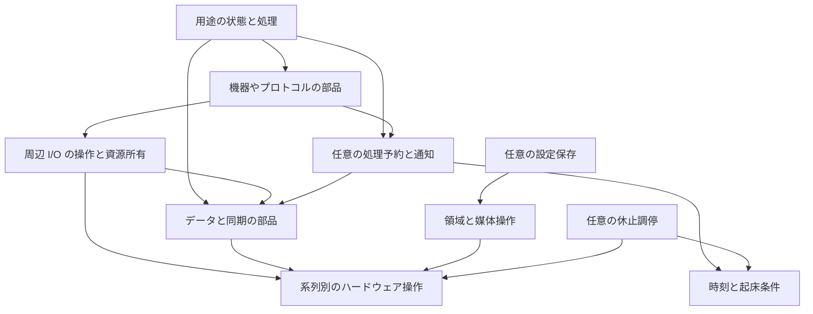

# CH32RV コア全体設計案

P0 DESIGN-01 の成果物。版 P0-1、2026-10-19。
実装・公開 API の仕様ではなく、P1 で比較条件を具体化するための全体像である。
本文の「契約案」は候補を具体的に評価するための仮置きであり、P5 の採用決定とは区別する。

[全体計画](../../CORE_REDESIGN_PLAN.ja.md)に従い、既存実装・既存 API・現行の対象外方針を制約にしない。
利用コードと状態遷移は [利用例の設計](usage-sketches.ja.md)、詳細な予備調査は [TODO から移した検討](todo-carried.ja.md) を参照する。

2026-10-22追記：本案の候補・契約は未採用のまま保持する。
現在は[判断中心の作業計画](decision-focus.ja.md)に従ってG1〜G5を横断し、全体構成の選択を先に進める。
各候補の全機能を完成させることを選択の前提にしない。

## 理想と利用者の責任

目指す候補は、小型 CH32 の資源を見通しながら、周辺機能と短い処理を組み合わせて使えるコアである。
利用者が状態・時間・容量を学べる程度に見せ、レジスタ操作や各プロジェクト固有の進行管理を繰り返し書かずに済む範囲を探る。

想定する利用者は、Arduino の基本的な関数や C/C++ は使え、小容量 MCU に合わせた書き方を学ぶ人と、
部品の費用を把握してアプリを作る人。無変更移植のために待機や実行の意味を曖昧にすることは優先しない。
教育のために全レジスタや複雑な汎用イベント定義を入口から要求することも避けたい。

| コアが引き受ける責務の案 | 利用者・用途側が持つ責務の案 |
|---|---|
| 操作開始・進行・完了・失敗を一定の規則で扱う | 処理を短く分割し、次に進む条件と状態を保持する |
| バス・timer・DMA 等の所有と競合を明示する | 必要な機器、端子、容量、処理頻度を選ぶ |
| ISR と通常処理の間で使えるデータ部品を用意する | 保持すべきデータと集約してよい通知を選ぶ |
| 受理・満杯・未対応・失敗を区別して返す | 容量不足、通信失敗、再接続時の用途の動作を決める |
| 起動・時間・sleep・保存の物理差を能力として示す | 保存の保護範囲、休止できる時間、許容する遅延を選ぶ |
| 基本例と完成例で同じ規則を説明する | buffer や要求 object の寿命を守る |

コアの規則に沿っても、戻らない通常処理を同一コアの協調実行で中断することは期待しない。
通常処理の時刻保証は行わず、WDT は独立した停止検出・復旧の選択とする。
PD 等の外部条件を満たすための IRQ・ハードウェアへの分担や失敗報告は必要で、遅延許容をプロトコル条件の緩和とはしない。

## 責務と依存方向

次は論理的な区分で、各区分を常駐 object や別 class にする指定ではない。
矢印は利用する側から利用される側を示す。

ドライバが進行通知を必要とする場合は、直接関数呼び出し・関数と context・型による接続等を比較する。
全ドライバから汎用実行器への直接依存を強制しない。機能が休止条件を提示する場合も、不要な構成から登録機構を除去できる接続を検討する。

| 部分 | 保持するもの | 常設を避けたいもの |
|---|---|---|
| 起動と系列能力 | 初期値、使用する clock と端子・周辺資源の情報 | 未使用の周辺初期化、全サービスの registry |
| 周辺操作 | 実行中の要求、必要な buffer、資源 owner | 全機能共通の最大サイズ request、無条件の転送 queue |
| データ部品 | 指定容量と管理情報、必要な同期状態 | timer・scheduler・購読表への強制依存 |
| 実行・通知 | 選んだ work／event と再実行条件 | 各仕事の独立 stack、使わない event payload |
| 機器・プロトコル | 機器固有の状態・規則 | アプリの表示方針や入力操作の意味 |
| 保存 | 選んだ領域、形式、保護の管理情報 | 一律の複数消去領域、全量 RAM cache |
| 診断 | 有効化した統計・状態 | 未使用時のログ buffer・計測 tick |

これは費用を隠さない設計目標である。除去できたことは ELF・map・実行観測で検証する。

## 比較する三つの全体構成

三案は別々の最終構成候補であり、A を製品化して B、C へ後から移る計画ではない。
各候補で V003 と X035 の両用途を記述し、方式間では同じ観測可能な機能を揃える。

| 項目 | A 明示的な状態機械 | B 短い処理の予約 | C 宛先付きイベント |
|---|---|---|---|
| 公開の中心 | I/O 操作、状態照会、queue・ring、時刻 | A の部品に加え、work と再実行条件 | I/O 操作とデータ部品に加え、mailbox と handler |
| 通常処理 | 利用者が順序を決めて step を呼ぶ | ready の work を有限件数だけ呼ぶ | 受理した event を有限件数だけ配達する |
| 待つ間 | 状態を保持して戻り、次の step で確認 | 状態を保持して戻り、通知・時刻で ready にする | 状態を保持して戻り、次の event で進める |
| 通知の表現 | 状態・flag・queue を直接確認 | 起動要求は集約。必要なデータだけ別 queue | 宛先と payload を持つ配達。集約と FIFO を区別 |
| system 処理 | ドライバ群の明示 pump。自動 pump は system 用接続として別比較 | system と利用者の work を同じ契約で扱い、容量枠は分離可能 | system と利用者で event 契約を共用し、mailbox は分離可能 |
| ユーザー処理の自動進行 | 基本は loop 内。delay 中にも進めたい場合は利用者が明示 step | loop 外・delay への接続は選択した domain のみ | 同左。登録と自動実行への参加を分ける |
| 学習上の利点の仮説 | 状態と呼び順を直接追える | 再実行の定型処理をまとめられる | 部品間の受け渡しと順序を追いやすい |
| 学習上の負担の仮説 | 多数の進行条件・呼び順を利用者が管理 | いつ ready になり、いつ実行されるかを理解する必要 | event 型、配達と処理完了、容量・所有の概念が増える |
| 主な費用 | 無条件の確認、定型状態・呼び出しの重複 | ready 管理、時刻管理、dispatch、接続情報 | queue、payload、宛先、配達、解除・寿命管理 |

A は単にレジスタを直接操作する案ではない。非同期 I/O、資源所有、独立したデータ部品をまとまった API で提供し、
通常処理の進行だけを利用者が明示する。自動進行の利便性が少ない対照としても使う。
B と C で system を別の枠へ分けても、同一 stack 上の長いユーザー処理から時間的に独立するわけではない。

C の購読配信は別の任意部品として比較する。宛先が既知の完了通知まで publish／subscribe にしない。
一つの通知を複数へ配る場合の payload 保持・一部受理・購読解除の費用を追加分として測る。

独立 stack を持つ task／RTOS は別実行モデルとして残す。A〜C で無理な状態分割が必要になった用途や、
待機 API の価値を比較する対照として P1 で対象を定める。内部で第二 stack を足して B と呼び続けることはしない。
専用 stack、文脈切替、待機 task・資源所有、コア間の規則、総 RAM を含む別条件として比較する。
RTOS の比較実装を作ることと、標準コアへ同梱することは別判断とする。

## 比較を具体化する共通の契約案

次の規則は A〜C の比較用の出発点。実装方式やクラス名を共通にする必要はない。
規則を変える候補を試す場合は、比較する差として記録する。

### I/O の状態と寿命

| 状態・操作 | 契約案 |
|---|---|
| 開始 | 受理／busy／未対応／引数不正を返す。受理は処理成功ではない |
| 実行中 | 要求 object と借用 buffer を再利用しない。hardware／IRQ と通常処理の責務を分ける |
| 完了 | 成功・失敗・cancel の終端結果を一つに確定する。通知が遅れても結果を照会できる |
| 回収 | hardware／DMA が buffer に触れず、結果を利用者が回収し、残る通知が古い参照を不正に使わないことを確認して再利用できる |
| cancel | cancel の受理と実際の停止完了を分ける。完了と競合しても結果を二重に確定しない |
| end・破棄 | 新規要求を止め、実行中要求と通知の参照が解放されたことを確認して破棄する |

同期完了でも任意のユーザー callback を開始 API 内へ不意に入れない案を基準とする。
即時完了の状態は照会可能とし、通知は指定した通常文脈で行う。inline callback の省コスト案は別条件で比較する。
token や接続世代を使う場合、番号だけで寿命問題が解けたとしない。古い参照を回収するまで再利用しない条件と番号の周回を定義する。

バスは transaction の開始から停止・復旧までを所有単位にする。複数 step にまたがる所有は bus 側の request で表し、
利用者が lock を保持したまま別 callback へ進むことを基本作法にしない。
busy を返す直接方式と、固定容量 arbiter へ受理する方式を比較する。転送 DMA の利用と開始 API の非ブロック性は別に検証する。

### 通知とデータの違い

- 最新状態が必要なものは、状態 object と集約通知を使う候補を置く。状態を読む前に通知を消す等、再通知を失わない手順が必要。
- 全件必要なものは queue にデータを保持する。満杯時の受理失敗を呼び出し元へ返す。上書きは明示した用途に限定する。
- 完了通知を失うと buffer を回収できない設計にはしない。結果状態＋集約通知、または受理時の完了枠予約を比較する。
- 通知登録と条件確認は一つの競合防止手順にする。単純な「空なら購読」の間に起こる到着を取りこぼさない。
- 順序は同一 queue 内、同一 request、同一 producer 等の単位で定める。別 queue・別コアの全体順序は暗黙に提供しない。
- データ部品の同期条件は通常処理専用、ISR と共有、複数 producer、コア間で区別する。すべてを一種類の重い lock に統一しない。

### Queue・ring・同期部品の公開面

「FreeRTOS 的な一式」は名称の互換ではなく、次の操作と責務を揃える候補として具体化する。
実行器なしで使える即時操作と、実行器へ接続する起床・待機補助を分けて費用を測る。

| 部品候補 | 即時操作と状態 | 比較時に決める点 |
|---|---|---|
| 値の queue | tryPush／tryPop、使用量、容量 | コピー・move・参照、満杯、複数 producer、非自明な型の破棄 |
| byte ring／stream buffer | 部分書き込み・読み出し、連続領域の借用と確定 | 部分受理、wrap、DMA の所有、複数 byte の message 境界 |
| message buffer | 長さ付き message の受理・取得 | 全体受理、最大長、領域不足、copy と借用 |
| flag／event bits | set、条件照会、競合しない取得・clear | any／all、消費と観察、複数待機者、取りこぼし |
| binary／counting semaphore | tryAcquire／release、上限 | 飽和、二重返却、owner を持たない通知との区別 |
| lock／critical section | tryLock／unlock、短い保護区間 | owner、再帰、IRQ 文脈、コア間、保護区間内で許可する操作 |
| 固定 block pool | tryAllocate／release、容量 | buffer の貸出・返却、二重解放、ISR と DMA との共有 |

全行の同梱を P0 で採用するわけではない。重なる機能は一つの部品で表現できるかも測る。
任意の待機補助は条件が成立したら仕事を再開可能にする形とし、通常の関数 stack を保持する待機とは区別する。
mutex の owner を task ID に依存させるか、文脈や明示 token とするかは別実行モデルとの境界になる。
協調実行の callback 間で lock を持ち越す仕組みを安易に追加しない。
優先度継承、待機者の公平性、timeout、ISR から許可する操作を、FreeRTOS に似た名称から推測させない。

### 実行機会と待機

B／C の基準候補では、一巡の件数上限と巡回開始時の対象を定め、実行中の再投稿は次回以降に回す。
work の実行前に現在の ready を消費し、実行中の新しい要求を次回へ保持する。件数制限は時間上限ではない。
通常処理へ戻ることと公平性を検査し、優先順だけで一つの仕事が実行枠を使い続ける案も負荷試験する。

| 呼び出し場所 | 基準として比較する動作 |
|---|---|
| 明示的な run／pump | 選んだ範囲を有限回進めて戻る |
| loop 外 | 自動参加させた範囲のみ進める。無効構成との費用差を測る |
| delay(0) | 同じ実行機会を一度提供する案と、明示 run 専用案を比較 |
| delay(n) | 進行を許可する範囲を固定して待つ案と、何も進めない案を比較 |
| work／handler 内 | 基準候補では再帰的なユーザー配達を抑止する。次回の仕事は保持する |
| ISR・割り込み禁止中 | 通常の run・ブロック待機は使わず、許可した即時操作・通知に限定 |
| setup・初期化途中 | 明示的に有効化した機能だけを進める。半初期化 object を配達対象にしない |

単一 stack の callback 内で delay(0) を呼んでも、基準候補では別のユーザー callback は進まない。
長い callback は状態を残して返す。通常の loop の長い処理中に呼ぶ delay(0) と区別して教える。
第二 stack や限定した再入を使う案は、深さ・循環待ち・所有を別契約として比較する。

待機の基本形は try 操作、非同期の完了・条件待ちとする候補を置く。同期 wrapper は独立した追加候補。
他の通常処理を止めて待つ場合は、IRQ／DMA／別コア等で条件が成立することと時間源の進行を確認する。
待機中に pump する wrapper は、呼び出し元の stack と資源を保持するため、基準の callback 内からは許可しない案を評価する。
すべての API に timeout 引数を付けるだけでは、進まない producer や循環待ちは解消しない。

## 起動と時間と低水準への入口

最小構成を、起動と必要な hardware 設定だけで利用できる候補にする。時刻源・timer 配達・delay の駆動を別の責務とする。
時刻取得だけの利用で周期割り込みや timer 表を要求するか、clock 変更・sleep 中に時刻がどう進むかを比較する。
wrap を跨ぐ時刻比較は、時刻幅と比較可能な期間を定義する。時刻の精度・分解能・配達遅延は別の値として提示する。

pin や instance をビルド時に特定する入口と、実行時に指定する入口のコード共有・費用を比較する。
Arduino 名の同期 API は、同じ名前だから隠れた進行を許すという扱いにしない。新規則を守れる wrapper、
呼び出せる文脈の制限、明示した非互換・未対応のどれにするかを一覧化する。

直接 hardware を使う入口は、所有中の peripheral を無断で書き換える裏口にしない。
資源を借りる／返す、ドライバを停止して引き渡す、最初からコア管理外にする等の候補を置く。
clock、IRQ、timer、DMA の共有条件を先に記述し、専用周辺機能は必要な利用者だけが参照する。

## メモリと永続化

通常の state、転送 buffer、queue 本体、管理情報、stack、保存作業領域を分けて示す。
固定容量 template、利用者提供 storage、runtime 容量、pool を比較し、heap を全機能の前提にしない。
診断を外した状態と入れた状態、header のみ・未登録・使用中・解除後の費用を区別する。

永続化は処理進行の方式と独立した境界として設計する。

| 境界 | 契約案と比較候補 |
|---|---|
| 領域 | offset と長さ、読み出し・program・erase の個別単位、所有。物理値は系列・型番ごとに調査 |
| 形式 | RAW、固定 blob、キー保存を比較。RAW 公開と内部専用も比較 |
| 保護 | 検出と復旧、1消去単位と複数領域、満杯時の停止・整理を比較。容量から保護を推測させない |
| 実行 | 保存要求の受理・実際の完了・失敗。hardware が CPU を止める場合を非同期 API の名前で隠さない |
| 配置 | linker、board menu、サイズ表示、upload の消去範囲を共通の領域定義に結び付ける |

V003 では1消去単位だけの予約を含めて評価し、予約バイト数、metadata、有効量、更新余地、作業 RAM を表示する。
読み出しと書き込みの粒度を同一と仮定しない。RAW とキー保存が同じ消去領域を同時に所有しない規則を設ける。
保存中に PD・通信が進められるか、事前に停止・退避が必要かは hardware 条件と用途の組み合わせで評価する。
非同期 commit が受理されたことと、電源断後も読めることを別の成功条件とする。

## Sleep と V006 の用途

時計・入力・表示を持つ用途では、用途側が休止方針を決め、I/O の終了・表示停止・起床条件を確認して休止する流れを候補にする。
全機能を列挙する休止 manager と、利用者が明示的に参加機能を集める方式を比較する。

1. 新しい UI 転送を止め、実行中要求を完了または cancel して buffer を回収する。
2. 入力の wake 条件と次回の時刻条件を設定し、sleep を妨げる資源利用を確認する。
3. 通知の確認から sleep へ入る間に出来事を失わない、系列別の手順を使う。
4. 復帰後に必要な clock・bus・機器状態を回復し、保留通知と時刻を扱う。
5. 遅れた周期処理を集約・回数通知・再基準化のどれにするか、用途に定めた規則へ戻す。

外部 RTC の壁時計と、経過時間・期限判定用の時計を分ける。低消費電力モードで実際に保持される内容は物理調査対象。
deep sleep の名称だけで実行継続や時刻保持を共通化しない。A は明示的な調停、B／C は pending 状態との接続を比較する。

## H417 と拡張シナリオ

能力のある機能だけを使う設計にし、系列名ごとの大きな汎用 object を基本 API に持ち込まない。
単一コアでは ISR との同期、複数コアでは memory ordering・共有領域・cache・DMA 等を別 backend の契約とする。

| シナリオ | 接続の案 | P1 へ渡す成立条件 |
|---|---|---|
| X035 の表示器を変更 | 同じ I2C transaction と完了契約へ機器ドライバを接続 | PD 状態・入力の意味を変更せず、buffer と描画費用の差だけを説明できる |
| 同じバスへタッチを追加 | bus arbiter または busy を扱う要求元を追加 | 描画分割で公平に進み、transaction 中に他機器を割り込ませない |
| 独立ライブラリが通知を使う | A の step、B の work、C の宛先へ適合 | system の非公開 queue を知る必要がなく、使用時だけ接続費用が発生する |
| H417 の各コアへ役割を分ける | コアごとの進行、所有する資源と message channel を明示 | callback の実行先を固定し、片側の遅延・停止・再起動を扱える |
| 別コアへ大量データを渡す | コピー message と、共有 block の貸出・返却を比較 | ポインタを渡すだけにせず、配置・可視性・回収を検証する |
| 保存先を外部媒体に変更 | 領域情報と read／program／erase、または上位 storage 境界へ接続 | 内蔵 Flash 固有の停止・保護保証を外部へそのまま適用しない |

H417 は単一コア使用、役割固定の両コア、共有実行器を比較する。共有実行器は所有が複雑になる独立候補とし、
最小コアの全 object に lock や core ID を加える前提にはしない。work ごとの stack とコアごとの通常 stack を区別する。
別 RTOS から使う境界を設けるなら、起床・時間・所有の adapter として検証し、task 安全性を自動的に継承するとはしない。

## 機能候補を全体像へ位置付ける

ここでは採否を変更せず、既存の現状欄を設計条件として使用しない。
新設計の調査では以下の境界へ結び付け、P5 で各項目の採否を決める。

| 候補群 | 全体像で先に確保する境界 |
|---|---|
| SYS-01〜09 | 保存領域、時刻・休止、clock・IRQ・WDT の責務と資源所有 |
| BUS-01〜14 | master／slave 等の能力、transaction・stream・frame、非同期結果、流量制御 |
| TIM-01〜08、ANA-01〜06 | hardware の時刻・trigger と通常通知、連続 buffer、timer の競合 |
| STO-01〜05、UPD-01〜02 | 媒体・形式・更新の境界、予約量と upload、復旧・移行の保証 |
| NET-01〜03 | 生フレーム・接続・上位 protocol の分離、buffer・進行・待機契約 |
| USB-01〜09、PD-01〜03 | role と controller の能力、転送所有、状態進行、復旧・切断、外部条件 |
| HW-01〜11 | 専用資源・memory の貸出、能力と配置。全系列への常設を要求しない |
| SCOPE-01〜06 | 対象製品・同梱範囲・別実行モデル・互換性。共通 API の拡張とは別に判断 |

GPIO 単発操作、bus transaction、連続 stream、protocol session の全てを一つの汎用 request に押し込まない。
状態遷移の意味を揃えつつ、保持すべき情報と使用資源の大きさに応じた部品として表現できるかを検証する。

## 教材としての構成

教材は「状態を観察する → 容量や処理量を変える → 複数機能を組む → 失敗から戻す」の順にする候補。
最初の例でも、完了と受理、待つことと戻ることの意味を後の完成例と変えない。

| 教材 | 変更課題 | 説明できてほしいこと |
|---|---|---|
| 周期出力と入力 | 周期・一回の仕事量を変える | 他処理が進む機会と、自分が保持する状態 |
| queue と通知 | 容量を減らす、最新値に集約する | データ消失と通知集約の違い、RAM との関係 |
| 非同期 I2C | 途中で表示内容を変える | 実行中 buffer と次に表示したい状態の違い |
| V003 I2C Knob | 設定を書き換えながら回す | IRQ と通常処理で一貫した値を扱う方法 |
| X035 PPS UI | 交渉中に再操作・切断する | 希望・実行中・成立の区別、古い完了の扱い |
| sleep と保存 | 休止前の処理と保存容量を変える | 完了・保持・再開の条件と、保証の範囲 |

コード行数だけでなく、利用者が予測できなかった動作、必要な説明、変更の波及、資源使用を観測する。
モデルによるレビューは事前点検とし、実際の利用者レビューを済ませた扱いにしない。

## 判断表と P1 への引き継ぎ

全項目が未採用。次の表の「絞り込み」は、比較軸を具体化したという意味である。

| ID | P0 で絞った問い | 比較する候補 | P1 で具体化する証拠 |
|---|---|---|---|
| D01 | 共通化の中心 | A 明示 step／B work／C 宛先 event | 両代表用途の同等機能、定型処理・総費用・変更課題 |
| D02 | 通常実行と stack | 協調実行／限定再入／独立 stack の対照 | 戻る性質、循環待ち、観測 stack、待機の記述量 |
| D03 | 自動進行の範囲 | 明示のみ／system のみ／明示参加した user も | loop・delay・callback・setup ごとの trace、未使用費用 |
| D04 | 通知と配信 | 状態＋集約／宛先 FIFO／任意の購読配信 | 再通知、満杯、fan-out、解除・寿命の検査 |
| D05 | I/O と回収 | sticky 結果／完了枠予約、busy／arbiter | cancel 競合、通知遅延、buffer 再利用、バス共有 |
| D06 | 待機の公開 | try／非同期待ち／独立同期 wrapper | producer が進む条件、依存・stack・再入の追加費用 |
| D07 | データと同期 | 固定容量／借用 storage／pool、文脈別同期 | 容量・型別費用、競合・overflow、ISR 禁止時間 |
| D08 | 最小 runtime | 明示初期化／接続時初期化、時刻源と timer の分離 | 起動・未使用・単独・複数機能の ELF と実行 trace |
| D09 | 永続化の範囲 | RAW／blob／キー、1単位／複数領域 | 物理仕様、容量・保護・停止・upload の成立条件 |
| D10 | Sleep の調停 | 明示的な参加一覧／任意 manager | wake 競合、時間の進行、再初期化、静止電流 |
| D11 | 系列とコア間 | 共通契約＋backend／規模別集合／共有実行器 | 能力差、所有・可視性、片側停止、最小構成への費用 |
| D12 | 公開・同梱・教材 | core／独立部品／用途例、低水準への入口 | 全候補の境界、外部接続、容量・理解・変更の評価 |

P1 は D01〜D08 を小用途・複合用途の共通条件へ落とし込み、D09〜D11 の物理調査と接続検証を並べる。
組み合わせを全探索せず、A〜C の基準を固定し、一度に変える差を明示する。
先に採用したい結論へ合わせて予算を作らない。何が測れれば候補を減らせるかを実験ごとに定義する。
P0 の完了は比較可能な全体像ができたことを示し、方式の性能・教育効果・全系列への成立を主張しない。
