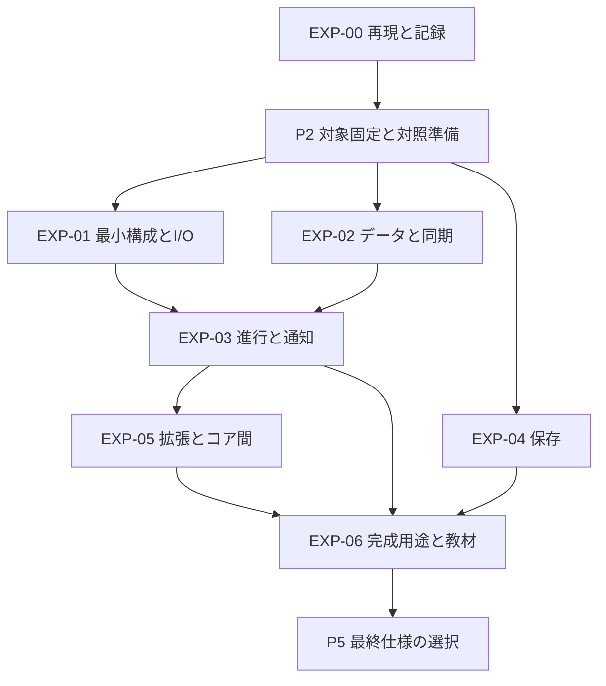

# 比較実験の実行順と作業範囲

版 P1-1。[比較契約](experiment-spec.ja.md)と[用途・刺激](workloads.ja.md)を固定して通常モデルが実行する作業。
P2〜P4 の担当は試作・検査・集計を進め、契約を変える必要が出た場合だけ高位判断へ戻す。
全ての実験を先に作る必要はなく、下記の開始条件を満たした単位から進める。

## 依存順とフェーズの完了条件

図の枝は依存関係で、別agentの同時起動を指示するものではない。
EXP-04／05 が実機未準備でも、K0／X0 のうち依存しない検証は進められる。
保存・休止・コア間の結合条件を未確認のまま P5 の該当仕様を確定しない。

| フェーズ | 終了時に必要なもの |
|---|---|
| P2 | EXP-00の再現、対象・一次資料・tool・入力の固定、hostの参照モデル、K0／X0のR対照のbuildと機能検査、Uとの機能差表、設備不足表 |
| P3 | EXP-01〜05の必要な部品比較、各候補の契約適合・費用・拡張接続。未検証の理由と影響を明示 |
| P4 | EXP-06の完成用途比較、故障条件、変更課題、利用者レビュー。必要な実機が欠ける場合は一部完了 |
| P5開始 | D01〜D12の証拠と反証が一覧化され、未検証が公開境界を変えるか判断できる |

P2 の R 対照を作ることは製品実装の開始ではない。試作と対照は tests の設備別配置へ隔離する。
hostの状態ロジックとcross compile用のソースは可能な範囲で同じものを使う。
fake backendを除いたtargetの不足がある場合は、host／compileのどちらができたかを分ける。

## P2 で先に固定する入力

通常モデルが資料の事実確認・設備要件の整理を行う。未知の仕様を推測して比較を始めない。
入力を確定する前に候補の数値を見て、条件を有利な方へ選ばない。

| 入力 | 固定する内容 | 不足時に進められること |
|---|---|---|
| V003・X035 | 正確なpart、ABI、clock、memory map、IRQ、必要周辺とroute、boot予約 | host契約、part非依存のリンク実験 |
| V006 | 同上＋各sleepモードの保持・時刻源・wake条件 | 仮想時刻・休止の競合検査 |
| H417 | コア別ISA・ABI・起動、共有領域、cache・DMA・memory ordering・通知・reset | message所有のhost模型。実可視性は未検証 |
| Flash | read／program／eraseの単位と整列、再program可否、停止・IRQ・耐久性・途中失敗の範囲 | 確認済み媒体モデルの形式比較。架空のgeometryは別の感度分析 |
| アップロード | リンク予約と各経路の消去範囲、保持オプション、bootとの衝突 | 生成設定・linker ASSERT・imageの範囲検査 |
| 用途 | K0のwire契約、X0のglyph・描画・PD分担、I2C速度、source・負荷・操作範囲 | hostの固定traceと失敗処理 |
| 観測 | marker・clockの分解能、PD trace、電流／電圧、reset条件 | 機能検査とサイズ。未取得の時間を0にしない |

一次資料は発行元、資料版、URL、取得日、hash、該当章／ページ、対象part、解釈を保存する。
WCHの入口は [V003](https://github.com/openwch/ch32v003)、
[V002〜V007](https://github.com/openwch/ch32v002_004_005_006_007)、
[X035](https://github.com/openwch/ch32x035)、[H417](https://github.com/openwch/ch32h417)。
実験に使う時点でcommitと資料を固定し、READMEの概要やサンプルの定数だけで物理仕様を決めない。
H417のV5F／V3Fという異なるコア構成も[メーカー概要](https://github.com/openwch/ch32h417)に示される。
各コアの命令・stack・共有RAMの条件は個別に照合する。

この段階で設備の接続・書き込みは不要。既存local fixtureの存在は、今回の用途の配線・相手・計測器が揃う証拠ではない。
実機作業では明示したfixtureと共通ロックを使う。通常pytestへ実機処理を入れず、
[testsの実行規則](../../tests/README.ja.md)に従って対象を指定する。
PD source、電源断、消費電流、H417の両コアは、それぞれ独立の設備要件として記録する。

## 各実験の依頼範囲

各項目のresultは `planning/core-redesign/tasks/EXP-xx/result.ja.md` に作る。
hostは `tests/unit/core_redesign/`、compileは `tests/platform/core_redesign/` を候補配置とし、
実機は `tests/single/`・`tests/peer/`・`tests/instrumented/` の契約に合う場所へ置く。
同名の現行製品APIを試作へ流用して将来の採用を既成事実にしない。

### EXP-00 再現性と結果の記録

開始条件は P1-1 が読めることと、指定compilerがあること。詳細は[実行依頼](tasks/EXP-00/brief.ja.md)。
既存18構成を独立した出力先で2回再現し、数値・symbols・入力を照合する。
共通manifestと失敗記録、再生成経路を整える。LTOや新しい実行モデルはここでは追加しない。
結果が変われば入力・tool・linkの差を調べ、旧値への書き換えで合わせない。
この結果は D08 の除去条件と、後続の測定基盤が信頼できるかを判断する材料。

### EXP-01 最小runtimeと周辺I/O

開始条件は EXP-00、対象part・tool・必要な物理資料の固定。
P2では最小の起動、K0／X0のR対照、共通renderer・入力traceを用意し、Uとの機能差を記録する。
P3では R/A/B/C に同じI/O backendを接続し、以下を比較する。

- 起動のみ、GPIO、時刻取得、I2C非同期transaction、2機能合成。tickやregistryを使わない構成も含む。
- 定数pinと実行時pin、直接操作と薄いclass、明示初期化と接続時初期化。
- IRQ／DMAで進む部分と通常処理が必要な部分、start／終端／cancel／endの契約。
- ISR側の短い必須処理と、通常文脈へ遅らせる処理の費用・禁止時間。

成果物は最小ELFとmap、起動・I/O trace、IO-01〜04の結果、全体と追加費用。
低水準を直接使う変更課題では、資源の引渡しと再初期化を検査する。
D05／D08／D12について、常設初期化・汎用request・wrapperを必要に応じて分離できるか判断する。
起動が実機未確認ならcompile結果として残し、実runtimeの最小費用と断定しない。
[I2C資源利用権の接続](tasks/EXP-01/i2c-resource-result.ja.md)はnative47件・ABI28構成で、open失敗の返却とend／takeまでのclock・pin保持を検査した。
PCLKとpin準備はadapterの宣言であり、実clock／pinmux／IRQ backendの成立とは分ける。
[X035準備adapter](tasks/EXP-01/x035-i2c-setup-result.ja.md)は公称PCLK確認・gate・default routeとpin設定をnative100件・ABI18構成で検査した。
packageごとのrouteと、実clock精度・配線・IRQ共有は別途確認する。
[X035 route／package比較](tasks/EXP-01/x035-i2c-route-result.ja.md)はnative136件・ABI68構成。C8 defaultのimage hashを維持し、F7の非対応pinとdebug未解放を拒否した。
物理pin競合・USBとの共存は未検証。

### EXP-02 データと同期

開始条件は EXP-00 とデータ型・同期文脈の固定。EXP-01の完成を待たずhost部を実行できる。
[部品の容量](workloads.ja.md#部品の容量と負荷)に従い、queue／ring／message／flag／semaphore／lock／poolを比較する。
即時操作だけ、通知付き、非同期再開付きの順に追加分を測る。固定templateと借用storageを基準比較に含める。
全組合せを先に作らず、通常処理専用→ISR共有→必要な複数producerを進め、コア間はEXP-05へ渡す。
非自明な型の構築・移動・破棄を必要とするqueueは、整数型とは別の機能として追加検査する。

[取得bufferの境界確認](tasks/EXP-02/acquisition-result.ja.md)は2 blockの所有・終端・返却と入力契約別の負荷をhost／ABIで記録した。
実DMA／ISR共有・完了枠との結合は残す。汎用poolとI/O所有期間の違いを区別する。

成果物は DATA-01〜03、容量とmetadataの表、未使用除去、操作費用・禁止区間、許可文脈の一覧。
D07／D06について、同じ部品の同期policyで足りるか、別classが分かりやすいか、待機補助の費用を判断する。
FreeRTOSと同じ名前だけで意味が一致するとせず、互換でない操作を明示する。

### EXP-03 実行機会と非同期処理

開始条件は EXP-01のI/O結果とEXP-02のデータ部品が、比較に必要な契約を通過していること。
M/S/U、A/B/C、work／event／timer、再入なし、busyの基準を固定して RUN-01〜03／TIME-01〜02 を検査する。
最初はhostで境界trace、次にtargetの費用、最後に実機の進行・遅延を測る。

追加比較は、完了枠予約、arbiter、fan-out 1／2／4宛先、解除・途中拒否、同期wrapper。
[完了枠とbus割当て](tasks/EXP-03/completion-arbiter-result.ja.md)はnative22件・最終ABI20構成で、専用3枠と共有2枠を比較した。
受理後の巡回と受理機会の公平性、backend回収と利用側takeを分け、実driver・event配達への接続は残す。
baselineの通常処理専用と、ISRから投稿する場合の費用を分ける。
独立stack対照は[待機の対照](workloads.ja.md#実行機会と待機の対照)の範囲でportと静的容量を調べる。
使うkernel／portの固定版・target適合・stack構成を記録できる場合に実装し、候補へ暗黙に混ぜない。
深さ制限付き再入は深さ1／2／4の人工例でstackと循環待ちを調べる。意味を変える場合は基準から別条件にする。

成果物は実行文脈表、通知・待機のtrace、各候補のサイズ・stack・処理費用・不足条件。
D01〜D06について、自動進行・公開配信・待機の利便性と費用を比較する。
非再入で記述が困難な用途が出た場合は、その最小例と候補を高位判断へ渡す。

### EXP-04 永続化と領域配置

開始条件は対象ごとの物理geometryと中断・再programの規則を一次資料で確認したこと。
RAW、固定blob、数値key保存を、1／2／4消去単位で試作する。
保護契約ごとに比較し、単純な上書きと旧値保持方式を同じ保証として順位付けしない。
host媒体モデルで操作境界の中断を検査し、実機では確認済みの中断範囲と電源条件で結果を照合する。
途中programの全bit組合せを列挙できない場合は注入集合を記録し、電断耐性の一般証明としない。

予約byteの生成、linkerの重複・境界ASSERT、board menu候補、ELF/image・upload経路の整合を検査する。
`NOLOAD`だけでuploadから保護した扱いにしない。保存中のCPU／IRQ停止とPD等の共存は独立に測る。
成果物はgeometry表、容量内訳、更新・復旧trace、停止時間、RAM、予約と消去範囲の証拠。
D09／D08について、公開RAWの範囲、キー方式・保証、容量指定、アップロード時保持の成立条件を判断する。

### EXP-05 拡張と複数コア

開始条件はEXP-03の基準候補の成立。所有のhost模型は先行可能。
表示交換、タッチ追加、独立ライブラリ接続、別系列のbackend、H417のmessage・block返却を実装する。
[表示交換と独立renderer](tasks/EXP-05/display-result.ja.md)は4 mock形式・chunkと配置の変更、独立build、16結合構成のhost／ABIを記録した。
実controllerのprotocol・停止／回収・物理wireと、H417等の能力確認は残る。
[H417の一次資料と公開順序](tasks/EXP-05/h417-preparation.ja.md)は5 PDF・固定SDK21 fileを照合し、
公開／取得／通知の3条件を有限模型で比較した。HSEMの成功判定の記述差、実可視性・DMA・resetは未解決。
[所有・回復の直列比較](tasks/EXP-05/h417-ownership-result.ja.md)はmessage16 B×4とblock64 B×2をsingle／fixed／shared-accessへ接続し、
native79件・ABI32構成で検査した。shared-accessは所有権限の比較であり、共有実行器は別途必要。
[host 2 threadの同期](tasks/EXP-05/h417-thread-result.ja.md)は同じ所有headerをmutex／atomic gateへ接続し、ASan／UBSanとTSanで検査した。
[message／block機能除去](tasks/EXP-05/h417-features-result.ja.md)は別headerで4機能構成を作り、native184件・ABI112構成で独立storageと未使用除去を検査した。
この機能除去の単位は直列検査であり、以前のTSan成功を新headerの証拠として数えない。
[feature型のhost並列](tasks/EXP-05/h417-feature-thread-result.ja.md)は別途ASan／UBSan83件・TSan80件で検査した。実行器・H417同期とは分ける。
[H417共有配置](tasks/EXP-05/h417-layout-result.ja.md)は固定SDK linkerで6 pairを検査し、通常RAM／stackからの分離を確認した。
固定32 KiB予約と使用byte数を区別し、NOBITSだけでupload保持を保証しない。共有C++ objectと初期化handshakeは未接続。
[共有予約の容量／未使用実験](tasks/EXP-05/h417-reservation-result.ja.md)は派生scriptの8 pair、link拒否8条件・混在拒否3条件で比較した。
未使用時はV3F通常RAMへ予約を戻す。pair照合をruntime handshakeの代わりにはしない。
H417は単一コア、コア別owner、共有実行器を別条件にし、コアごとのstack・制御情報と共有領域を数える。
片側停止・再起動、通知前後の可視性、cache／DMAの条件を独立に検査する。

成果物は接続に必要な差分と状態、追加依存、費用、CORE-01、最小V003構成への逆流がないことのlink比較。
D11／D12について、共通契約＋backendと規模別構成の境界を判断する。
host模型が通っても共有memoryの実動作を確認した扱いにしない。実機未準備は対象部分の未検証として残す。

### EXP-06 完成用途と教材

開始条件は各用途が使うEXP-01〜05の契約が成立していること。
K0とX0はR/A/B/Cの必須比較。取得bufferとV006休止は境界確認用、H417は独立した拡張確認として扱う。
[V006の資料と待機境界](tasks/EXP-06/v006-sleep-result.ja.md)と[回収・時刻・一覧の結合](tasks/EXP-06/v006-sleep-flow-result.ja.md)はhost／ABIで準備済み。
実driverの停止・再設定、待機adapterと実機SLEEP-01は残る。
[timer依存除去と段階失敗](tasks/EXP-06/v006-sleep-features-result.ja.md)は同じソースで追試した。転送を持たない条件として、以下の追加分と証拠を区別する。
[能動leaseとPrepare／Abort失敗](tasks/EXP-06/v006-sleep-lease-fault-result.ja.md)の432条件は追加済み。実driver・回収不能・IRQ共有の成立とは分ける。
完成用途で追加状態・buffer・バスの待機が増えることも含めてB0／B1／B2を評価する。
部品単体で最小だったものを組むだけで、完成用途も最小だと推測しない。

成果物は全体費用、正常・burst・切断・満杯のtrace、I/Oと入力遅延、残容量、変更課題と利用者レビュー。
sleepは表示等の周辺電源・デバッグ接続の条件を固定し、MCUのみとboard全体の電流を区別する。
D01／D10／D12を中心に、全Dの結果を統合してP5へ渡す。
「便利さに見合う」という評価は、機械計測と利用者の観察を並べて記し、モデルの印象だけで採用しない。

## 判断と証拠の対応

| 判断 | 必須の証拠 | その証拠で変わる判断 |
|---|---|---|
| D01 共通化の中心 | EXP-03＋06、R/A/B/CのK0とX0 | A/B/C、規模別構成、共通化を減らす選択 |
| D02 stack | EXP-03の深さ・待機・別stack対照 | 通常stack、再入、独立実行モデルの必要性 |
| D03 自動進行 | EXP-03 M/S/U、EXP-06負荷 | loop外・delayで進める範囲と登録規則 |
| D04 配信 | EXP-02＋03、満杯・fan-out・解除 | 状態通知、宛先event、購読配信の同梱範囲 |
| D05 I/O | EXP-01＋03＋06 | 結果保持、回収、cancel、busy／arbiter |
| D06 待機 | EXP-02＋03、producer別trace | try・非同期・同期wrapperの公開と禁止文脈 |
| D07 同期と容量 | EXP-02＋05、型・ISR・コア別 | class／policy、所有、固定容量・pool |
| D08 runtime | EXP-00＋01＋04、未使用と全体 | 初期化、時刻、保存予約、リンクで除去する境界 |
| D09 保存 | EXP-04＋06保存共存 | 形式・保護・容量・保存中に許す動作 |
| D10 休止 | EXP-03時間＋06 V006 | 明示調停／manager、時間の意味、保持条件 |
| D11 系列 | EXP-01＋05、物理資料と実機 | 共通境界、コア別backend、規模別API |
| D12 公開と教育 | EXP-05＋06、機能候補76項目との対応 | core／独立部品／用途例／対象外と教材 |

P5への結果表には各判断の支持・反証・未検証、比較条件、再現先を載せる。
通常モデルで解決できる実装不良は修正を続ける。契約変更、予算・負荷条件の変更、複数領域の矛盾は根拠を添えて高位判断へ戻す。
