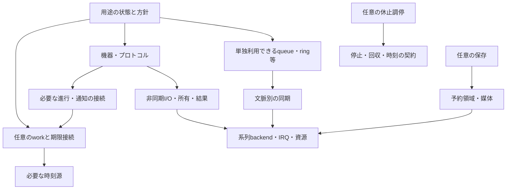

# 全体構成の選択案：短い処理の予約を任意に組み込むコア

2026-10-22、提案版1。状態：**推奨案作成済み・第三者レビュー未実施・最終決定なし**。
[判断中心の計画](../../decision-focus.ja.md)のP5前半、G1〜G5を一体で選ぶための資料。
既存実装との互換・移行容易性は選択の制約にしない。製品コード・Accepted ADRは変更しない。
根拠資料の参照基準はGit `0a8909efc99b284197b873c2420896302e091f70`。各測定の入力版はリンク先の記録を優先する。
整理途中のE05未コミット資料を、この提案の数値根拠には使用しない。

## 推奨の要点

**B「短い処理の予約」を組み立ての中心とし、非同期I/O・queue等は実行器なしでも使える構成を推奨する。**
通常処理はコアごとに一つの実行経路へ直列化し、各workは状態を持って短く戻る。
独立task stack・再帰dispatch・汎用イベント配信を標準の前提にしない。

Bをすべての構成へ常設する提案ではない。K0のように呼び順が小さく固定された用途は、同じI/O・データ契約を直接使える。
これはA製品からB製品への段階移行ではなく、**最終仕様の時点から、下位部品の単独利用と任意のwork接続を用意する**案。
この分離が最終実装でも除去可能かは検証が必要で、既存試作の測定値を新構成の完成費用とはしない。

提案するコンセプトは「小型CH32で、状態・容量・所有を見通しながら、短い処理と周辺機能を組み合わせるコア」。
呼び順・通知・資源管理を各アプリが一から作る負担を減らし、処理分割や失敗時の判断は利用者が学んで選べるようにする。
対象の中心はV003／V006／X035。上位系列は共通の意味を継承し、backendと構成を分ける。

これは実測だけでBの優越を証明した結論ではない。**Aの小ささは観測できているが、Bの組みやすさ・教育効果は仮説**。
利用者の希望と既存の制約からBを優先案に置き、Aを有力な反対案としてレビューする。

## 判断の優先順

1. 受理・所有・停止・回収・実行文脈の意味が一貫していること。
2. 小型構成へ不要なexecutor・timer・配信・共有状態の固定費を持ち込まないこと。
3. K0からX0へ、同じ規則で組み合わせを増やせること。
4. 利用者が進行・容量不足・寿命を説明し、変更できること。
5. 採用構成のFlash／RAM／stack／速度を改善すること。

重み付き点数は付けない。未測定の教育効果や実時間を数値評価に混ぜない。
「小さい」だけで必須の失敗処理を落とした案を勝者にせず、同じ意味の比較を優先する。

## 全体の選択肢

| 選択肢 | 利用者が組む形 | 選ぶ理由 | 負担・反対材料 | 今回の位置 |
|---|---|---|---|---|
| A 共通部品＋明示step | loopから状態機械を呼ぶ。queue・I/Oは共通部品 | 呼び順を見通せ、既存K0／X0試作の費用が小さい | 起動条件、周期、再試行、複数部品の進行接続が用途側へ寄る | **最有力の対案**。Bの接続が複雑なら中心をこちらへ戻す |
| B 共通部品＋短いwork | 状態を保持して返り、通知・期限で次の実行を予約 | 状態機械を保ちながら再実行の定型をまとめられる。system／userの接続を共通化できる | executor・ready・登録の費用と概念が増える。単純用途で常設すると不利 | **推奨**。単独部品と明示stepの入口を維持する |
| C 宛先event中心 | mailbox・handlerで処理をつなぐ | 全件の受け渡しや宛先が設計の中心となる用途で表現しやすい | 状態変化までpayloadにすると容量・配達・解除・結果保持の責務が増える | 任意のtyped queue／adapterで表現。汎用busを中心には置かない |
| 別stack／RTOS中心 | 通常の関数内で待ち、別taskが進む | stack上の途中状態を保持でき、逐次的な処理を記述しやすい | stack・切替・同期・停止の別契約を要する。小型中心の狙いに追加負担 | 標準提供を推奨しない。外部実行系との接続境界は残す |

Cの固定宛先と動的購読は別の能力。Bのworkは起動要求を集約し、データ全件保存はqueueへ明示的に任せる。
RTOSの価値をリアルタイム性だけに限定しない。また今回の対照からFreeRTOS一般の最小費用や他チップの優劣を結論しない。

## 選択材料：観測事実と限界

### 同等用途ロジックの費用

次は既存の測定値。どちらもRV32E・LTOなし・明示進行M。K0は設定容量1、X0はtouch初期無効。
**独立のlogic probeであり、起動・実driver・IRQ・stack peakを含む完成firmwareではない。**
X0のRV32EはABI比較で、V003上のPD機能・用途成立を意味しない。

| 条件 | R（直接対照）image／静的RAM B | A | B | C |
|---|---:|---:|---:|---:|
| K0 | 1152／96 | 1152／96 | 1420／120 | 1872／128 |
| X0 | 3286／372 | 3286／372 | 3774／400 | 3902／384 |

出典：[K0結果・matrix](../EXP-06/k0-result.ja.md)、[X0結果・matrix](../EXP-06/x0-result.ja.md)。
K0ではBはR比+268 B image／+24 B静的RAM、X0では+488／+28 B。
CはX0でBより静的RAMが小さいが、固定宛先batchの条件。entryの単一frameはR/A 28 B、B 44 B、C 72 Bで、peakは未測定。
K0の全24対はAとRのimage／静的RAMが一致。X0の全24対は静的RAM差0、image差0〜28 B。

**解釈**：共通部品そのものが常に大きな費用を伴うという仮説には反証がある。
ただしBの費用は実在し、単純用途にも必須にする根拠は弱い。数値だけならAを選ぶ材料の方が強い。
B推奨は、追加費用を任意化したうえで進行接続をまとめる価値を重視する設計判断である。

### その他の判断材料

| 観測事実 | 提案へ使う解釈 | 証明していないもの |
|---|---|---|
| X0のcompile時touch offは手で除いた版と全16対でimage／RAM一致。runtime無効よりRAM24 B減 | 不使用の構成要素を型・リンク単位で外す価値がある | 最終コアの全機能が0 Bで外れること。[機能除去](../EXP-06/x0-features-result.ja.md) |
| 別stack512 BのX035例は継続型よりRAM総予約+644 B。通常stack予約1024 Bは両方に含む | stackを保持する便利さには明確な容量項目が増える | 512 Bが必要最小・安全であること、実IRQ／切替時間。[2 stack](../EXP-03/two-stack-result.ja.md) |
| 表示をrequiredにした模型では、表示停止が次のsource受理を止める。最新状態へ置換する案では制御側が進む | 最新表示・全件command・I/O完了を同じ配送保証に統一しない | 実PD／X0の期限成立。[表示の扱い](../EXP-03/completion-optional-result.ja.md) |
| waiterが資源を保持すると、pumpを繰り返してもproducerが進めない反例がある | 汎用の「待ちながら全部進める」を標準にしない | 任意コードのdeadlockを自動検出できること。[依存](../EXP-03/dependency-result.ja.md) |
| backend回収と利用者の結果takeを分け、別要求の通信中に旧結果を保持できた | 周辺解放、結果保持、buffer再利用を別の契約にする | 実DMA／IRQの停止。[回収分離](../EXP-01/i2c-handoff-result.ja.md) |
| 休止前にI/Oだけを確認すると未完了jobを残す反例がある | 休止にはwork／I/O双方の停止・保持状態が必要 | 実wake競合・clock復帰・電流。[休止](../EXP-06/sleep-work-result.ja.md) |
| H417模型で共有transportとcore-local実行器を分離し、host並列を検査できた | 共通契約と各coreの実行器を分ける余地がある | 実HSEM／cache／reset／両core起動。[transport](../EXP-06/h417-transport-result.ja.md) |
| V003保存共存の一例で保存追加RAM220 B、1 fast erase単位の予約64 B | 小さなFlash予約でも管理RAMは小さいとは限らない。保存は任意機能にする | 最小保存実装の費用・実電断保護。[保存](../EXP-06/save-k0-result.ja.md) |

異なるprobeの数値は足し合わせない。実時間・全体fit・使いやすさは未測定を残す。

## 推奨する責務と依存方向

図は責務であり常駐classの指定ではない。下位I/O・データ部品から汎用executorへの必須依存を作らない。
ドライバの通常処理が必要な場合は明示service入口を持ち、work接続または直接呼出しで同じ状態機械を進める。
**同じobjectを二つの進行元で動かさない**。直接呼出しとwork接続はそのobjectのbinding時に選び、運転中に混在させない。

### G1：提供する便利さと利用者の責任

コアはI/Oの受理・完了・取消・回収、容量付きデータ部品、必要な処理の予約、系列差の能力表示を引き受ける。
利用者は状態分割、容量、全件保持か最新値か、復旧・保存・休止の方針を選ぶ。
教材では「長い処理を短く戻す」「受理は成功ではない」「通知とデータは別」「満杯と寿命を扱う」を一貫して教える。
基本例は明示stepでもよいが、X0例はworkへ接続する。異なる所有・待機規則を教え直す構成にはしない。

### G2：一つの通常実行経路、明示参加する自動進行

各coreに通常実行の文脈を一つ置き、taskごとのstack保持は標準提供しない。
これは割り込み用stack領域まで一本に固定する指定ではない。IRQ入口・保存領域は系列backendの責務。
通常callbackから別の通常callbackをdispatchする再入は、別executorを経由する場合も含め抑止する。
そのため、systemとuserを分けても長いuser callbackからsystemを時間的に独立させることはできない。

| 場所・操作 | 推奨する意味 |
|---|---|
| loopから明示run | 指定した実行器の登録済み・実行可能workを有限件数進める。自動参加していないuserも対象にできる |
| loop外／loop中のdelay(0) | 初期化・有効化済みsystem serviceと、**明示的に自動参加したuser workだけ**を一巡進める |
| loop中のdelay(n>0) | 時間を待ちながら同じ許可範囲へ有限の進行機会を与える。callback分の超過を許し、復帰時刻を保証しない |
| work／通常callback中のrun | Reentrantを返してdispatchしない。別executorへ迂回しても同じ |
| work／通常callback中のdelay(0) | dispatchせず戻る。長いcallbackを救済するyieldとして使えない |
| work／通常callback中のdelay(n>0) | 時間待ちのみで他workを進めない。使い方の基本は期限と状態を残して戻る。voidのdelayをエラー値付きAPIと偽らない |
| setup | 自動dispatchはまだ開始しない。明示runは初期化・binding済み対象だけに可能。constructor中は不可 |
| ISR／IRQ禁止区間 | 通常dispatch・delay・ブロック待機は不可。文脈に適合した即時操作と通知だけ |
| delayMicroseconds | 低水準の時間待ちとしてdispatchを持たせない |

systemとはdriverの内部進行・回収等であり、任意の利用者callbackをsystemから呼ぶ抜け道を作らない。
ライブラリが利用者関数を呼ぶ部分もuser配達に分類し、実行許可と寿命を引き継ぐ。
systemの参加はdriverの有効化と接続で明示し、userの登録と自動参加は別操作にする。
自動進行を使わない構成はhookを外せる。同じAPIの隠れたボード別挙動ではなく、構成・bindingで明示する。

一巡は開始時のready集合を有限件数だけ選び、同じworkは一巡一回。巡回位置を保持し、再投稿は次巡へ残す。
system／参加userにそれぞれ実行枠を設け、systemの再投稿だけでuserを永遠に選ばない設計は避ける。
これは実行機会の規則であり時間保証ではない。通常処理が返らなければ次巡は来ない。
時間制約のあるprotocol処理はIRQ／hardwareへ分担し、それで成立しない機能は対応を限定する。WDTは独立した任意の復旧手段。

時刻読出し、期限管理、callback配達を分離する。timerを使わない構成へtimer表やtickを要求しない。
期限到達は通常進行時に確認してworkをreadyにし、timer自身からuser callbackを呼ばない。
周期の遅れは既定で最新1回へ集約し、取り逃した回数を観測可能にする案。履歴が必要なら用途がqueueで保持する。
時刻の周回を扱える期間を明示し、sleep後の経過が不明なら期限を成功扱いせず再設定を要求する。
具体的な時刻幅・型は公開前に確定するが、未知の経過を推定で埋めない境界は今選ぶ。

### G3：受理・実停止・回収を分ける

I/Oは受理された要求ごとに終端結果の置き場所を確保する。Busy／Full等の拒否では所有を移さない。
要求・借用bufferは利用者が寿命を維持し、backendが触れる間は再利用しない。
停止を確認して周辺を解放できても、利用者の結果回収と残る参照の解消まではbufferの貸出を終えない。
取消要求やtimeoutだけでは貸出を解放しない。止まらないbackendでは回収不能として保持し、成功したように続けない。

結果の保持が正本、work通知は「確認してほしい」という集約可能な起動要求とする。
完了通知の取りこぼし・user停止で結果を消さない。登録と状態確認の競合、ready消費と再投稿の競合を同期契約に含める。
動的解除は受理閉鎖→実行中処理・I/O・通知参照の終了→破棄可能の順。destructorが隠れて待つ設計にしない。
初期教材は寿命の長い明示objectで組むが、解除・closeの境界も最終仕様に最初から含める。
世代番号は古い参照が残る間に再利用せず、枯渇時は新規受理を拒否する。通常poll回数を無制限の識別子消費に結び付けない。

### G4：公開部品、通知と待機の範囲

| 提供範囲の推奨 | 公開する意味 |
|---|---|
| Queue、Ring／StreamBuffer、MessageBuffer | 即時try、容量と使用量。値queue／messageは全体受理、byte streamは部分受理を区別。満杯は黙って上書きしない |
| Flag／EventBits、binary／counting semaphore | 即時の設定・消費・try取得／返却。集約・全件保持・ownerの違いを明示。task待機者は内蔵しない |
| CriticalSection、短いTryLock、固定BlockPool | 文脈別の短い保護と貸出。lockを持ってcallback間を待たない。task mutexの優先度継承・再帰・待機順を暗黙提供しない |
| Work、期限と再実行条件 | 起動を集約。workはpayloadの保存先ではない。条件を確認して短く返す |
| 宛先queue＋workの接続 | 必要な用途でtyped messageを渡す。配達完了と処理完了を区別する |
| 汎用publish／subscribe | 任意ライブラリの拡張候補。標準driverの必須経路にはしない |
| 同期wait wrapper | 標準queue等に無条件のblocking版を付けない。必要なら**通常の最外層だけ**の明示adapterとして検討。進行対象・時計・資源依存を呼出し側が契約する |

列挙した部品は最終的な提供範囲の推奨。すべてを実装してからコアを評価する作業順ではない。
固定容量または利用者提供storageを基本にし、heapを必須にしない。単独・ISR共有・core間の同期能力を区別する。
単一coreのIRQ禁止をcore間排他へ読み替えず、未対応の共有文脈は設定時に拒否する。
Arduino名の同期関数も個別に「実行時間中は誰が進むか」を定め、暗黙の全user pumpを共通ルールにしない。
callback内のブロック処理をpreemptionや強制resetで矯正する機構は標準にしない。

### G5：系列と任意機能の境界

| 領域 | 今選ぶ境界 | 後段へ残すもの |
|---|---|---|
| V003から上位系列 | 同じ所有・進行・失敗の意味。能力とstorageは構成別。小型から上位へ同じ巨大classを配置しない | 各portの命令・容量・最適化 |
| H417／将来の複数core | 各coreのlocal executorと明示transport。callback・contextの共有や自動移動を標準にしない。共有payloadと公開・取得・返却を分離 | 実HSEM／cache／起動・停止・reset、共有executorが必要な用途 |
| 外部RTOS | 必要なら一つの指定taskがcore-local進行を所有するadapter。外部taskからは対応transport等で渡す。一般のAPIを自動thread-safeにはしない | 特定RTOSのport。二重のdispatcher所有は許さない |
| 永続化 | 任意のRAW媒体／領域と、その上のblob／key保存。geometry・予約・保護・停止影響を明示。1消去単位の選択を閉ざさない | 形式、key型、wear leveling、menu値、具体的な電断保証。公開前に互換性と保証を確定 |
| 休止 | 用途が明示要求。参加者の新規受理閉鎖、work／I/Oの停止・保持・回収、wake確認、clock復帰を契約する。loopの空きを自動sleepと同一視しない | 省電力managerの具体構造、実wake手順・電流最適化 |
| 時間・保存停止 | 非同期というAPI名だけでCPU／IRQが進むとしない。clock domainの不連続と媒体の停止影響を通知する | 型番ごとの停止時間・時刻源・実通信との共存 |

この範囲はH417の完全対応やRTOS同梱の約束ではない。後から接続するときに基礎の寿命・文脈を変更しないための境界。
独立機能の具体API・保存形式は、その機能を公開する前までに選ぶ。

## 既存試作から、この提案へまだ確認が必要な差

既存のB試作が通ったことを、この提案全体の検証済みとはしない。
特に次は個別模型の材料はあるが、提案どおりに一つのruntimeへ接続して確かめていない。

- 別executorを含むcore単位の非再入と、実際のdelay／setup／loop外hook。
- systemと参加userの実行枠を両方進める巡回と、その追加状態・費用。
- 明示serviceとwork接続の択一binding、IRQからの通知登録・条件確認・ready消費の統合。
- optional work／timer／同期backendを外した完成用途の残容量と起動依存。

これらは採用案の成立条件であり、推奨の事実上の採用を先に進める理由にはしない。
レビューで案を変更した場合は、新しい案に関係する不足だけを引き継ぐ。

## この推奨に対する強い反対理由

- **Bがアプリを楽にする証拠が弱い。** 起動接続やreadyの管理が、短いstep列より難しいならAがよい。
- **任意化だけでは複雑さを消せない。** A相当の直接経路とB経路を両方保守する費用がある。同一状態機械を一方のbindingで進める境界が守れなければ分離を見直す。
- **自動参加したcallbackはloopから見れば途中への介入である。** delayを呼ぶ時点でそのcallbackが観測する状態を一貫させる必要がある。これを教えにくければ自動進行をsystem限定に狭める。
- **非再入では長いcallback中のsystem進行は止まる。** systemだけ再入させる案にも資源依存と寿命の複雑化がある。必須用途が分割不能なら別stack等を再検討する。
- **小型用途全体の残容量が未確認。** logic probeの+24 B等を、そのまま最終予算の余裕とは扱えない。

## 最終決定までの最小の確認

第三者レビューを先に行う。以下を全条件・全候補の一括実験へ拡大しない。

| 確認 | 必要な理由・最小範囲 | 結果で変える判断 |
|---|---|---|
| R1 利用コードの読み合わせ | [具体例](usage.ja.md)のK0／X0について、実行場所、再投稿、満杯、貸出終了、表示停止を第三者が予測する。教育効果を主張する前には想定利用者にも確認 | BのbindingがAより定型負担を減らさない、またはsystem／userを繰り返し誤るなら、A中心または自動進行S限定へ |
| R2 任意workの依存・全体予算 | 優先案を試作する場合、V003 K0のworkなし／ありとX035 X0の必要構成だけ。共通startup・linker・I/O境界で静的RAM、予約、stack余地、未使用依存を分ける。比較前に用途へ残す予算を合意して固定 | workなしでもexecutor／timer等が残る、または必要用途の予算を割るなら境界を修正。Bを全用途必須にはしない |
| R3 進行境界の最小反例 | 一つのruntime接続でloop→delay→work、work→delay／別executor、ISR通知とready消費、timer遅延、解除中の終端を確認。既存host結果で足りる行は再実行しない | userの再入、取りこぼし、停止前の貸出解放が起きるならG2〜G4を確定しない |
| R4 外部protocolの必須条件 | X035 PD／I2Cのうち通常処理へ依存する必須の進行を特定。資料照合で決まらない条件だけ、対象・相手を固定して実観測する | 必須処理がIRQ／hardwareに分離できず、協調実行で用途が成立しないなら、対応範囲または実行モデルを見直す |

R2は完成製品を先に作る要求ではない。構造を判別できる最小の縦の試作に限り、stackの宣言値を実測peakとしない。
R4はH417や全周辺の完成待ちではない。物理条件が契約を変え得る部分は、確定前の不足として残す。
レビューで疑問が解消し、既存証拠で判断できる項目に新しい実験を要求しない。

## 判断台帳

| 判断 | この提案の選択 | 状態 |
|---|---|---|
| G1／D01・D12 | 小型中心。単独部品と任意workで定型処理をまとめる | 推奨・未承認 |
| G2／D02・D03・D06・D08 | core-local単一通常経路、非再入。system＋明示参加userの自動進行。汎用blocking待機は標準外 | 推奨・未承認。特に自動user参加はレビュー重点 |
| G3／D05・D07 | 結果保持と通知を分離、停止と回収を区別、明示容量・文脈別同期 | 推奨・未承認。物理backendの停止は未検証 |
| G4／D01・D04・D12 | Bを中心、typed queue接続は任意、汎用配信は別部品 | 推奨・未承認。教育・便利さは仮説 |
| G5／D08〜D11 | 共通の意味＋系列backend、local executor＋transport、保存／休止／RTOS接続を任意化 | 推奨・未承認。各機能の実対応は別途検証 |

第三者への依頼と回答様式は[レビュー依頼](review-request.ja.md)。レビュー前にAccepted ADRや製品APIへ反映しない。
