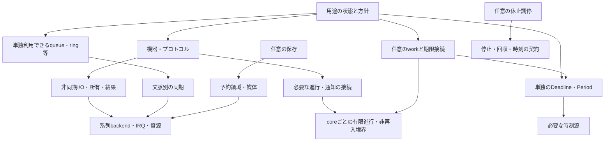

# 全体構成の選択案：明示stepとsystem自動進行を中心にするコア

2026-10-22、提案版4。状態：**レビュー04への修正提案・provider例外を含む最終選択前**。
[レビュー04](review-04.ja.md)は版3を条件付きで支持し、providerと一括配達の判断を求めた。
[応答と選択肢](review-04-response.ja.md)を確認する。版4の再レビュー・利用者承認は未了。
[判断中心の計画](../../decision-focus.ja.md)のP5前半、G1〜G5を一体で選ぶための資料。
既存実装との互換・移行容易性は選択の制約にしない。製品コード・Accepted ADRは変更しない。
根拠資料の参照基準はGit `0a8909efc99b284197b873c2420896302e091f70`。各測定の入力版はリンク先の記録を優先する。
E05の追加資料は、この提案の数値根拠には使用しない。版1は `7996108`、版2は `f076a8e`、版3は `ac0071b` に保持する。過去のレビューが支持した版と今回の案を区別する。

## 推奨の要点

**Aを基本に、system自動進行と通常user処理の明示実行を分ける。専用APIで登録したprotocol providerだけはsystem中で呼べる例外を提案する。**
必要なsystem serviceは成功したbegin()で自動登録する。通常の通知callback／user workは直接呼出しまたは明示run・配達だけ。
通知配達は任意の共通入口で一回にまとめられる。providerは「相手への応答に必要な限定操作」であり、一般の通知を自動配達する許可ではない。
**providerを使う場合は、setup／loopのdelay中にも利用者が書いた関数が動き得る。** 版3の厳密なS限定からの変更で、採用は未決定。
Bのwork予約は任意部品として最終構成に残すが、利用者コードや下位I/Oの必須依存にしない。
K0の基本教材はAだけ、X0もA＋単独の期限部品を基本にする。Bは必要な用途で比較する応用側へ分ける。

これは暫定AからBへの段階移行ではなく、**最初からAを中心に、単独部品・system進行・任意workの境界を分ける**案。
通常処理はコアごとに一つの実行経路へ直列化し、独立task stack・再帰dispatch・汎用イベント配信を標準の前提にしない。
未使用部品が最終buildで除去されるかは検証が必要で、既存試作の測定値を完成費用とはしない。

コンセプトは「小型CH32で、状態・容量・所有を見通しながら、短い処理と周辺機能を組み合わせるコア」。
queue・ring・期限・I/Oの定型を共通化し、処理分割や失敗時の判断は利用者が学んで選べるようにする。
対象の中心はV003／V006／X035。上位系列は同じ意味を継承し、backendと構成を分ける。

Aの小ささは既存模型で観測され、レビュー03ではAの分かりやすさとBの接続負担が報告された。
これは既定の推奨を変える材料だが、初学者一般の教育効果や全用途の優劣の証明ではない。
Bの利便性は用途ごとに判断する。自動user配達を含む版2は対案として履歴に残し、黙って最終採用した扱いにはしない。

## 判断の優先順

1. 受理・所有・停止・回収・実行文脈の意味が一貫していること。
2. 小型構成へ不要なexecutor・timer・配信・共有状態の固定費を持ち込まないこと。
3. K0からX0へ、同じ規則で組み合わせを増やせること。
4. 利用者が進行・容量不足・寿命を説明し、変更できること。
5. 採用構成のFlash／RAM／stack／速度を改善すること。

重み付き点数は付けない。未測定の教育効果や実時間を数値評価に混ぜない。
「小さい」だけで必須の失敗処理を落とした案を勝者にせず、同じ意味の比較を優先する。

## 全体の選択肢

| 選択肢 | 利用者が組む形 | 選ぶ理由 | 負担・反対材料 | 今回の位置 |
|---|---|---|---|---|
| A 共通部品＋明示step | loopから状態機械を呼ぶ。queue・I/Oは共通部品 | 呼び順を見通せ、既存K0／X0試作の費用が小さい | 共通Deadline／Periodを使えても、確認順や起動条件の集約は用途側が持つ | **推奨する基本形**。systemは自動、userは明示 |
| B 共通部品＋短いwork | 状態を保持して返り、通知・期限で次の実行を予約 | 状態機械を保ちながら再実行の定型をまとめられる。system／userの接続を共通化できる | executor・ready・登録の費用と概念が増える。単純用途で常設すると不利 | 任意の応用部品。明示runだけで実行し、Aの必須依存にしない |
| C 宛先event中心 | mailbox・handlerで処理をつなぐ | 全件の受け渡しや宛先が設計の中心となる用途で表現しやすい | 状態変化までpayloadにすると容量・配達・解除・結果保持の責務が増える | 任意のtyped queue／adapterで表現。汎用busを中心には置かない |
| 別stack／RTOS中心 | 通常の関数内で待ち、別taskが進む | stack上の途中状態を保持でき、逐次的な処理を記述しやすい | stack・切替・同期・停止の別契約を要する。小型中心の狙いに追加負担 | 標準提供を推奨しない。外部実行系との接続境界は残す |

Cの固定宛先と動的購読は別の能力。Bのworkは起動要求を集約し、データ全件保存はqueueへ明示的に任せる。
RTOSの価値をリアルタイム性だけに限定しない。また今回の対照からFreeRTOS一般の最小費用や他チップの優劣を結論しない。

## 選択材料：観測事実と限界

### 同等用途ロジックの費用

次は既存の測定値。RV32E・LTOなし、Mは明示進行、Sはsystemのみの自動機会を模した入口。K0は設定容量1、X0はtouch初期無効。
**独立のlogic probeであり、起動・実driver・IRQ・stack peakを含む完成firmwareではない。**
X0のRV32EはABI比較で、V003上のPD機能・用途成立を意味しない。

各セルは **image／静的RAM／entry単一frame**、単位B。

| 条件 | R（直接対照） | A | B | C |
|---|---:|---:|---:|---:|
| K0 M | 1152／96／16 | 1152／96／16 | 1420／120／36 | 1872／128／40 |
| K0 S | 1152／96／16 | 1152／96／16 | 1428／120／36 | 1876／128／40 |
| X0 M | 3286／372／28 | 3286／372／28 | 3774／400／44 | 3902／384／72 |
| X0 S | 3298／372／28 | 3298／372／28 | 3782／400／44 | 3910／384／72 |

[転記と入力hash](review-01-cost-context.csv)。Sも実delay／USB／PD driverを組み込んだ費用ではない。
frameは既存archive内の `.su` と一致を確認した静的な単一関数値であり、全call chain／IRQを含むstack peakではない。
M→S差を「system service全部の費用」、A→B差を「user予約だけの費用」と分解できる実験ではない。

出典：[K0結果・matrix](../EXP-06/k0-result.ja.md)、[X0結果・matrix](../EXP-06/x0-result.ja.md)。
MではK0のBはR比+268 B image／+24 B静的RAM、X0では+488／+28 B。Sではそれぞれ+276／+24 B、+484／+28 B。
CはX0でBより静的RAMが小さいが、固定宛先batchの条件。entryの単一frameはR/A 28 B、B 44 B、C 72 Bで、peakは未測定。
K0の全24対はAとRのimage／静的RAMが一致。X0の全24対は静的RAM差0、image差0〜28 B。

**解釈**：共通部品そのものが常に大きな費用を伴うという仮説には反証がある。
ただしBの費用は実在し、単純用途にも必須にする根拠は弱い。数値だけならAを選ぶ材料の方が強い。
版4もAを中心に選ぶ。Bを残す理由は必要な用途で起動条件をまとめる選択肢であり、Bの教育効果が実証されたためではない。

### その他の判断材料

| 観測事実 | 提案へ使う解釈 | 証明していないもの |
|---|---|---|
| X0のcompile時touch offは手で除いた版と全16対でimage／RAM一致。runtime無効よりRAM24 B減 | 不使用の構成要素を型・リンク単位で外す価値がある | 最終コアの全機能が0 Bで外れること。[機能除去](../EXP-06/x0-features-result.ja.md) |
| 別stack512 BのX035例は継続型よりRAM総予約+644 B。通常stack予約1024 Bは両方に含む | stackを保持する便利さには明確な容量項目が増える | 512 Bが必要最小・安全であること、実IRQ／切替時間。[2 stack](../EXP-03/two-stack-result.ja.md) |
| 表示をrequiredにした模型では、表示停止が次のsource受理を止める。最新状態へ置換する案では制御側が進む | 最新表示・全件command・I/O完了を同じ配送保証に統一しない | 実PD／X0の期限成立。[表示の扱い](../EXP-03/completion-optional-result.ja.md) |
| waiterが資源を保持すると、pumpを繰り返してもproducerが進めない反例がある | 汎用の「待ちながら全部進める」を標準にしない | 任意コードのdeadlockを自動検出できること。[依存](../EXP-03/dependency-result.ja.md) |
| backend回収と利用者の結果takeを分け、別要求の通信中に旧結果を保持できた | 周辺解放、結果保持、buffer再利用を別の契約にする | 実DMA／IRQの停止。[回収分離](../EXP-01/i2c-handoff-result.ja.md) |
| 休止前にI/Oだけを確認すると未完了jobを残す反例がある | 休止にはwork／I/O双方の停止・保持状態が必要 | 実wake競合・clock復帰・電流。[休止](../EXP-06/sleep-work-result.ja.md) |
| H417模型で共有transportとcore-local実行器を分離し、host並列を検査できた | 共通契約と各coreの実行器を分ける余地がある | 実HSEM／cache／reset／両core起動。[transport](../EXP-06/h417-transport-result.ja.md) |
| V003保存共存の一例で保存追加RAM220 B、1 fast erase単位の予約64 B | 小さなFlash予約でも管理RAMは小さいとは限らない。保存は任意機能にする | 最小保存実装の費用・実電断保護。[保存](../EXP-06/save-k0-result.ja.md) |

異なるprobeの数値は足し合わせない。実時間・全体fit・使いやすさは未測定を残す。
レビュー03のOEP用途は62,568／63,488 B、残り920 Bという報告。ソース版・ELF・条件は未照合で、新しい測定結果ではない。
上のRV32E模型の増分をX035 OEPへ加算してfitを判定しない。容量余裕が小さい用途にBを必須化しない判断材料として使う。

## 推奨する責務と依存方向

図は責務であり常駐classの指定ではない。下位I/O・データ部品から汎用executorへの必須依存を作らない。
ドライバの通常処理が必要な場合は明示service入口を持ち、system runtimeへの接続または直接呼出しで同じ状態機械を進める。
**同じobjectの通常側ownerは一つとし、同時実行・再入を許さない。呼出し箇所の数とは区別する。**
同じownerの明示serviceとruntime経由serviceが順次呼ばれることは許容できるが、余分な呼出しを不要にするのがbindingの役割。
serviceは有限の進行を一回行うので、複数回で結果が変わらない「冪等」を一般要求にはしない。
照会（ready等）は状態を読み、tryStartは受理・開始、tryTakeは回収を行う。いずれも裏で汎用pollやuser配達を行わない案を推奨する。
通常側の進行が必要なdriverはserviceへの接続を要する。これを照会の頻度に依存させない。
非再入guardは割り込みとの共有同期を代替しない。ISRとの状態共有・通知の公開順序は別の同期契約で守る。

### G1：提供する便利さと利用者の責任

コアはI/Oの受理・完了・取消・回収、容量付きデータ部品、必要な処理の予約、系列差の能力表示を引き受ける。
必要なdriver内部処理の登録忘れをbeginとの一体化で防ぐ。任意の診断では登録状態とservice／workの実行統計を見せる。
計測点の共通化はwork接続の具体的な利点だが、費用や教育効果は未測定。loopの明示stepも任意の同じ計測口で囲める。
利用者は状態分割、容量、全件保持か最新値か、復旧・保存・休止の方針を選ぶ。
教材では「長い処理を短く戻す」「受理は成功ではない」「通知とデータは別」「満杯と寿命を扱う」を一貫して教える。
K0／X0の基本例は明示stepと必要なsystem進行を示す。Bへの接続は応用側で扱い、異なる所有・待機規則を教え直さない。

### G2：system進行、明示通知配達、限定providerを区別する

各coreに通常実行の文脈を一つ置き、taskごとのstack保持は標準提供しない。
割り込み用stack領域まで一本に固定する指定ではなく、IRQ入口・保存領域は系列backendの責務。
通常dispatch中は別の仕事をdispatchしない。別executorへの迂回も抑止する。登録済みproviderの同期呼出しは選択中のsystem処理の一部で、別dispatcherを開始するものではない。
長いuser callback／providerからsystemを時間的に独立させることはできない。非再入規則は残る。

| 場所・操作 | 推奨する意味 |
|---|---|
| setup／loopから明示run・配達API | 指定した初期化済み対象だけを有限件数進める。通常通知は任意の共通入口でまとめて配達でき、実行場所は呼出し側が選ぶ |
| setup／loopのdelay(0)、AfterLoop hook | begin成功で登録済みsystemを有限に進め、明示登録したproviderはその中で呼ばれ得る。通常通知／user workは配達しない |
| setup／loopのdelay(n>0) | 時間を待ちながら同じsystem進行の機会を与える。実行分の超過を許し、復帰時刻は保証しない |
| dispatch中のrun／配達API | Reentrantを返し実行しない。別executorでも同じ |
| dispatch中のdelay(0)／delay(n>0) | 他処理をdispatchしない。0は戻るだけ、n>0は時間待ちのみ。長いcallbackのyieldには使えない |
| constructor／ISR／IRQ禁止区間 | 通常dispatch・delay・ブロック待機は不可。ISRは文脈に適合した即時操作と通知だけ |
| delayMicroseconds | 低水準の時間待ちとしてdispatchを持たせない |

systemはdriver内部の進行・回収等。通常の受信通知等をsystem扱いで自動配達する抜け道を作らない。
ただしprotocol要求への返答／受理判定を利用者実装へ委任するproviderは、専用の明示登録を条件にsystemから同期呼出しする案。
provider本体と参照stateをbegin前に初期化し、登録時・begin途中では呼ばず、begin成功後から呼出し可能にする。
providerはIRQでは呼ばず、所属coreの通常system文脈で短く返す。run／配達の再入、delayによる進行待ち、完了待ちspinをしない。
この制約は任意コードの実行時間を保証する機構ではない。未準備・失敗を定義し、長い処理の遅延応答は対応protocol／backendだけで提供する。
providerの受理と最終完了を混同せず、buffer・参照の保持はG3に従う。delay前に共有stateを整え、providerが必要なlockを保持してdelayしない。
providerから通常通知をinline配達しない。通知は結果・受信を有限に保持し、明示配達までの満杯・損失を機能ごとに規定する。
列挙等の内部進行を通常の通知callbackへ依存させない。固定情報で答える内部backendとproviderが必要な操作を分ける。
以下は能力の切分け候補であり、全クラスの提供・時間成立を約束する表ではない。

| 機能・操作の例 | providerにする範囲 | 通常通知／事前公開で扱える範囲 |
|---|---|---|
| MSC等の媒体応答 | 利用者媒体への読出し・書込み受理等、返答に必要な限定操作 | 容量等の初期設定、既定backend、完了通知。媒体操作全部を短い同期関数にできるとはしない |
| HID／vendor control | 動的な応答生成・要求の受理判定が必要な場合 | 固定report／事前公開snapshot、受理後の通常通知。要求別に分類する |
| CCID／DFU等 | 応答に必要な限定操作。長い処理は対応する遅延応答契約が必要 | 内部状態・保持済み応答、処理後の通常通知。即時成功で完了したように見せない |
| CDC等の受信通知 | onRx自体はproviderへ昇格させない | read／takeまたは明示配達。buffer満杯を隠さない |

通常通知の登録成功には、その配達元を任意の共通入口へ接続することも含める既定案とする。
`runtime.deliverUserOnce()`等の一回で有限巡回できるが、delay／AfterLoopからは呼ばない。callback登録時も即時配達しない。
機能別配達と共通配達は同じ通知状態を消費し、二重消費・再入を許さない。再通知は次巡へ残し、解除は参照排出後。
共通配達はBのwork全体をrunするものではない。callbackを使わずread／takeする場合は配達登録不要で、未使用一覧・queue・Bを常設しない。
照会だけのbusy waitは通常serviceを進めない。通常側の進行を要する完了を待つ場合はdelay等へ到達する必要がある。
診断では最後のservice時刻等を任意に保持できるが、通常処理が止まったその場で警告を実行できるとは約束しない。
systemの参加は必要なdriverのbeginに含めることを既定とする。通常通知の登録は自動参加を意味しない。providerの明示登録だけは上記の例外。
begin成功は初期化と必要なservice登録の両方の成立を意味し、相手との通信や媒体操作の完了を意味しない。固定配列方式なら登録枠不足は明示失敗にし、未初期化objectをdispatch対象に公開しない。
失敗時は予約を取り消し、安全に停止できない部分はfaultとして保持する。成功を返したままservice未登録になる経路を作らない。
再beginで二重登録せず、通常owner／所属coreを一つに固定する。end／closeは新規受理と新たな通常workの選択を止め、必要な停止・回収進行を維持してI/O・callback・参照を排出してから登録を解く。
begin中にdelayを呼んでも、そのdriver自身は初期化完了まで進まない。他の初期化済みsystemは表の条件で進み得る。
自動進行を使わない構成はManualService等を初期化前に指定し、必要なserviceを同じownerから明示実行する。これは依存除去や進行位置を選ぶ上級向けで、基本教材は既定の自動登録を使う。
稼働中のdetachによる移管は停止・回収・参照解消を要し、単に登録を消して寿命を終えない。具体API名は未定。
通常serviceが不要なdriverは登録枠を持たない。system側も含め未使用hook・判定表・null判定を常設する指定ではない。
ManualServiceを実行時に選ぶだけで自動登録のcodeまで除去できるとは限らない。型・build構成等で自動経路を外せる境界を用意し、R2で確認する。
任意の登録一覧診断はowner、system／user、通常通知／providerの文脈、稼働状態を観測できる口とする。名前文字列・全件snapshot領域を常設しない。
登録storageは固定配列／driver内node等を公開前にR2の限定比較で選ぶ。共通契約は登録成立・owner・寿命で、固定容量の枠を全方式へ要求しない。
表は文脈が優先する。setupから明示配達されたcallback内のdelayもdispatch中の行に従い、systemへ再入しない。

一巡は開始時のready集合を有限件数だけ選び、同じworkは一巡一回。巡回位置を保持し、再投稿は次巡へ残す。
systemの一巡とuserの明示runは別の機会。どちらも無限にdrainせず、userを呼ぶ頻度は用途が選ぶ。
これは実行機会の規則であり時間保証ではない。通常処理が返らなければ次巡は来ない。
時間制約のあるprotocol処理はIRQ／hardwareへ分担し、それで成立しない機能は対応を限定する。WDTは独立した任意の復旧手段。

時刻読出し、期限状態、起動接続、callback配達を分離する。
Deadline／PeriodはAから単独利用でき、時刻値と保持した期限を比較するだけで中央timer表・tick・callback登録を要求しない。時刻源自体の費用は別にある。
Bを使う場合の期限接続は任意executorの明示runで確認し、workをreadyにする。timer自身からuser callbackを呼ばない。
任意Bのattach成功は初回readyを設定し、実行は次の明示runまで行わない。接続を完了してからrunする。
期限・周期接続はexecutorへの一操作にまとめる案とし、別のruntime参加操作を要求しない。容量不足・解除・通知競合の契約は維持する。
周期の遅れは既定で最新1回へ集約し、取り逃した回数を観測可能にする案。履歴が必要なら用途がqueueで保持する。
時刻の周回を扱える期間を明示し、sleep・外部clock変更等で経過が不明なら期限を成功扱いせず再設定を要求する。
具体的な時刻幅・型は公開前に確定するが、未知の経過を推定で埋めない境界は今選ぶ。

### G3：受理・実停止・回収を分ける

I/Oは受理された要求ごとに終端結果の置き場所を確保する。Busy／Full等の拒否では所有を移さない。
要求・借用bufferは利用者が寿命を維持し、backendが触れる間は再利用しない。
停止を確認して周辺を解放できても、利用者の結果回収と残る参照の解消まではbufferの貸出を終えない。
取消要求やtimeoutだけでは貸出を解放しない。止まらないbackendでは回収不能として保持し、成功したように続けない。
復旧は明示操作として、受理閉鎖→backend依存の停止／reset／回復→静止確認→結果回収→再開を用意する。
静止確認はDMA、実行中／保留IRQ、他core、遅延した通常処理が古いbufferへ触れない条件を含む。
確認できた未終端要求だけを一度だけAbortedへ確定する。既存終端を上書きせず、reset直後も利用者のtakeと残参照解消まではbufferを返さない。
backendの新世代と旧結果の回収を分け、世代更新で旧leaseのtakeを不能にしない。再開は再初期化成功後で、未回収recordは保持する。
RCC reset命令の実行やbusの線が解放されたことだけで、memoryへのアクセス停止を証明した扱いにしない。
失敗／Unsupportedなら閉鎖と貸出を保持して明示faultを返す。安全な停止手段がないbackendまで復旧可能と約束しない。

結果の保持が正本、work通知は「確認してほしい」という集約可能な起動要求とする。
完了通知の取りこぼし・user停止で結果を消さない。登録と状態確認の競合、ready消費と再投稿の競合を同期契約に含める。
動的解除は受理閉鎖→実行中処理・I/O・通知参照の終了→破棄可能の順。destructorが隠れて待つ設計にしない。
初期教材は寿命の長い明示objectで組むが、解除・closeの境界も最終仕様に最初から含める。
世代番号は古い参照が残る間に再利用せず、枯渇時は新規受理を拒否する。通常poll回数を無制限の識別子消費に結び付けない。

### G4：公開部品、通知と待機の範囲

| 提供範囲の推奨 | 公開する意味 |
|---|---|
| Queue、Ring／StreamBuffer、MessageBuffer | 即時try、容量と使用量。値queue／messageは全体受理、byte streamは部分受理を区別。満杯は黙って上書きしない |
| Flag／EventBits、binary／counting semaphore | 即時の設定・消費・try取得／返却。集約・全件保持・ownerの違いを明示。task待機者は内蔵しない |
| CriticalSection、短いTryLock、固定BlockPool | 文脈別の短い保護と貸出。lockを持ってcallback間を待たない。task mutexの優先度継承・再帰・待機順を暗黙提供しない |
| 単独Deadline／Period | 時刻と期限の比較・再設定。executorを使わず、周回・domain不連続を扱う |
| 任意Work、期限接続と再実行条件 | 起動を集約。workはpayloadの保存先ではない。条件を確認して短く返す |
| 任意の登録診断・実行統計 | service／workの開始・終了と一巡の計測口。回数・経過時間の累計と観測最大、周期取り逃し等を必要な構成だけで記録する |
| 任意の共通通知配達 | 登録済みの通常通知を一回の明示呼出しで有限に配達。Bの利用を要求しない |
| protocol provider | 専用APIで登録した限定操作だけを通常systemから同期呼出し。時間保証・汎用user自動配達ではない |
| 宛先queue＋workの接続 | 必要な用途でtyped messageを渡す。配達完了と処理完了を区別する |
| 汎用publish／subscribe | 任意ライブラリの拡張候補。標準driverの必須経路にはしない |
| 同期wait wrapper | 標準queue等に無条件のblocking版を付けない。必要なら**通常の最外層だけ**の明示adapterとして検討。進行対象・時計・資源依存を呼出し側が契約する |

列挙した部品は最終的な提供範囲の推奨。すべてを実装してからコアを評価する作業順ではない。
固定容量または利用者提供storageを基本にし、heapを必須にしない。単独・ISR共有・core間の同期能力を区別する。
単一coreのIRQ禁止をcore間排他へ読み替えず、未対応の共有文脈は設定時に拒否する。
同期backendはV003等のA拡張を前提にしない構成では短いIRQ maskの保存・復元を候補とし、
対応する命令・memory領域ではatomic操作、複数coreではHSEM等と公開順序／cache処理の組合せを検証して選ぶ。
A拡張の有無だけで、全操作のIRQ禁止要否や構造全体の安全性を決めない。ownerを分けたSPSC等は別条件で評価できる。
IRQ禁止の対象範囲、解析上の上限が得られる条件、実測の観測最大と測定条件を分けて公開する。
実測最大を保証上限とはしない。原子的なRMW命令や非再入flagだけでも、複数fieldのsnapshotやDMA可視性は保証しない。
Arduino名の同期関数も個別に「実行時間中は誰が進むか」を定め、暗黙の全user pumpを共通ルールにしない。
callback内のブロック処理をpreemptionや強制resetで矯正する機構は標準にしない。

診断の境界は今用意するが、カウンタ幅・表示形式・全統計の実装は後段へ残す。
記録する経過時間には途中のISR等も含まれ、CPU占有時間やWCETではない。時刻源の周回・domain不連続・集計overflowの扱いを定め、無効な試料を成功値へ混ぜない。
readyがない一巡は「空の巡」であってCPUアイドルではない。計測外のloop・busy wait・IRQ・動作中の周辺が残り得る。
dispatch内の経過割合、計測外時間、休止backendが確認した実休止時間を区別する。空き割合だけで休止可能時間を推定しない。
診断なしでは時刻読出し・counter・名前表・計測専用tickを要求しない。無効時の追加0 Bを目標にR2で確認し、有効時の費用も実測する。8〜12 B等の固定見積りは仕様にしない。

### G5：系列と任意機能の境界

| 領域 | 今選ぶ境界 | 後段へ残すもの |
|---|---|---|
| V003から上位系列 | 同じ所有・進行・失敗の意味。能力とstorageは構成別。小型から上位へ同じ巨大classを配置しない | 各portの命令・容量・最適化 |
| H417／将来の複数core | 各coreのlocal executorと明示transport。callback・contextの共有や自動移動を標準にしない。共有payloadと公開・取得・返却を分離 | 実HSEM／cache／起動・停止・reset、共有executorが必要な用途 |
| 外部RTOS | 必要なら一つの指定taskがcore-local進行を所有するadapter。外部taskからは対応transport等で渡す。一般のAPIを自動thread-safeにはしない | 特定RTOSのport。二重のdispatcher所有は許さない |
| 永続化 | 任意のRAW媒体／領域と、その上のblob／key保存。geometry・予約・保護・停止影響を明示。1消去単位の選択を閉ざさない | 形式、key型、wear leveling、menu値、具体的な電断保証。公開前に互換性と保証を確定 |
| 休止 | 用途が明示要求。参加者の新規受理閉鎖、work／I/Oの停止・保持・回収、wake確認、clock復帰を契約する。loopの空きを自動sleepと同一視しない | 省電力managerの具体構造、実wake手順・電流最適化 |
| 時間・保存停止 | 非同期というAPI名だけでCPU／IRQが進むとしない。clock domainの不連続と媒体の停止影響を通知する | 型番ごとの停止時間・時刻源・実通信との共存 |

clock不連続はsleep専用にせず、外部のclock設定変更・clock喪失・関係する復旧操作を検出対象にする。
backend resetだけで時刻源まで変わったとは限らないため、device世代とtime domainは別に管理する。
内部serviceへ再設定要求を渡すだけでなく、利用側もDomainChanged／期限無効を状態として観測できるようにする。
観測可能であることはuser callbackを即時配達することではない。自動でSystemInitを呼ぶ方法や毎tickのregister読出しは採用しないまま、検出能力と費用をbackend別に評価する。
実行中の任意clock切替APIは今回の標準範囲に入れない提案。既存コードにAPIがないことを将来の永久対象外の根拠にはしない。

この範囲はH417の完全対応やRTOS同梱の約束ではない。後から接続するときに基礎の寿命・文脈を変更しないための境界。
独立機能の具体API・保存形式は、その機能を公開する前までに選ぶ。

## 既存試作から、この提案へまだ確認が必要な差

既存のB試作が通ったことを、この提案全体の検証済みとはしない。
特に次は個別模型の材料はあるが、提案どおりに一つのruntimeへ接続して確かめていない。

- 別executorを含むcore単位の非再入と、実際のdelay／setup／loop外hook。
- 通常通知を自動配達しないこと、providerの限定呼出し、system巡回・共通明示配達・任意workの分離。
- driverのowner・非再入と、照会／try／serviceの操作区分、IRQからの通知登録・条件確認・ready消費の統合。
- setupのsystem進行とuser保留、明示復旧から旧結果回収までの経路、外的clock不連続の公開状態。
- beginによる自動登録の成功／失敗／再初期化／終了、ManualServiceでの依存除去、任意診断の有無。
- optional work／timer／同期backendを外した完成用途の残容量と起動依存。

これらは採用案の成立条件であり、推奨の事実上の採用を先に進める理由にはしない。
レビューで案を変更した場合は、新しい案に関係する不足だけを引き継ぐ。

## この推奨に対する強い反対理由

- **Aは何もないstepも確認する。** 低頻度の仕事が多い用途では、起動条件を集約するBの費用が見合う可能性がある。
- **通常user回収の呼び忘れは残る。** systemが進んでも、受信callbackや結果の回収は明示呼出しまで止まる。有限bufferの満杯を隠さない教材が必要。
- **provider例外は自動実行の理解を難しくする。** 利用者が書いた関数がdelay中に動く。許容できなければ事前公開データ／明示応答を選び、機能や容量の制約を受け入れる。
- **一括配達にも費用がある。** 一覧だけでなく保持・消費・解除の状態を含めて評価し、未使用構成へ常設しない。
- **任意Bも提供・説明の費用を持つ。** K0へ持ち込まず、具体的な便益がある応用だけで評価する。
- **非再入では長いcallback中のsystem進行は止まる。** 必須用途が分割不能なら対応範囲や実行モデルを再検討する。OEPでの成立報告を全用途へ一般化しない。
- **休止の情報はAでは用途側に散らばり得る。** Bなら集約できるが、readyなしだけで休止できるわけではない。同じI/O・wake・期限条件でAとも比較する。
- **小型用途全体の残容量は未確認。** 模型やOEPの報告値だけで最終コアのfitを約束しない。

全workを毎巡確認するBの任意診断は、接続漏れを疑う手掛かりとして後段候補にする。
入力再生・副作用・周期を限定して比較し、挙動差を漏れの断定、差なしを漏れ無しの証明にしない。費用は未測定。

## 最終決定までの最小の確認

レビュー04は版3を条件付きで支持した。次は版4のprovider例外と一括明示配達を含む優先案を選ぶ。以下を全条件・全候補の一括実験へ拡大しない。

| 確認 | 必要な理由・最小範囲 | 結果で変える判断 |
|---|---|---|
| R1 利用コードの読み合わせ | [具体例](usage.ja.md)のK0／X0について、実行場所、setup中のprovider、通常通知の明示配達、delayなしspin、満杯、貸出終了、表示停止を第三者が予測する。レビュー03は用途・読解の定性評価として記録し、盲検予測や初学者評価の完了とはしない | A中心でも用途が書けない、providerと通常通知の区別や明示配達を誤るなら境界・教材を修正する |
| R2 任意workの依存・全体予算 | 優先案を試作する場合、V003 K0のworkなし／ありとX035 X0の必要構成だけ。共通startup・linker・I/O境界で静的RAM、予約、stack余地、未使用依存を分ける。ManualServiceの自動登録依存除去、登録storageの固定配列／intrusiveの限定比較、同一構成の統計off／on一対も確認。一括配達／providerを使わない構成の依存除去と、採用する場合の最小追加費用を同じ縦の試作で確認する。比較前に用途へ残す予算を合意して固定 | 不要なexecutor／timer／診断等が残る、または必要用途の予算を割るなら境界を修正。Bを全用途必須にはしない |
| R3 進行境界の最小反例 | 一つのruntime接続で登録方式に応じたbegin失敗・再begin・終了、setup／loop→delayではsystemと明示providerだけ、通常通知は共通／個別明示配達、明示run→work、work→delay／別executor、照会の副作用、ISR通知とready消費、timer遅延、provider内run抑止・未準備、共通／個別配達の二重消費防止、解除中の終端を確認。V003共有部品の実IRQ・禁止区間は対応を公開する前に対象条件で検証。既存host結果で足りる行は再実行しない | userの再入、取りこぼし、停止前の貸出解放が起きるならG2〜G4を確定しない |
| R4 外部protocolの必須条件 | X035 PD／I2Cのうち通常処理へ依存する必須の進行を特定。資料照合で決まらない条件だけ、対象・相手を固定して実観測する。復旧能力を提供するbackendはreset後のDMA／IRQ／旧参照停止と旧結果回収を確認する。providerを提供する選択機能は同期／遅延応答の成立と借用条件を確認し、USB全クラスの先行実装へ広げない。 | 必須処理がIRQ／hardwareに分離できず、協調実行で用途が成立しないなら、対応範囲または実行モデルを見直す |

R2は完成製品を先に作る要求ではない。構造を判別できる最小の縦の試作に限り、stackの宣言値を実測peakとしない。
R4はH417や全周辺の完成待ちではない。物理条件が契約を変え得る部分は、確定前の不足として残す。
レビューで疑問が解消し、既存証拠で判断できる項目に新しい実験を要求しない。

## 判断台帳

| 判断 | この提案の選択 | 状態 |
|---|---|---|
| G1／D01・D12 | 小型中心。Aの明示stepと単独部品が基本、Bは任意応用 | 推奨・未承認 |
| G2／D02・D03・D06・D08 | core-local単一通常経路、非再入。beginでsystem自動登録、通常userは明示呼出し、限定providerだけ例外。汎用blocking待機は標準外 | 推奨・未承認。登録寿命・user配達許可はレビュー重点 |
| G3／D05・D07 | 結果保持と通知を分離、停止と回収を区別、明示容量・文脈別同期 | 推奨・未承認。物理backendの停止は未検証 |
| G4／D01・D04・D12 | system進行の共通基盤、任意work・typed queue・診断、汎用配信は別部品 | 推奨・未承認。教育・便利さは仮説 |
| G5／D08〜D11 | 共通の意味＋系列backend、local executor＋transport、保存／休止／RTOS接続を任意化 | 推奨・未承認。各機能の実対応は別途検証 |

レビュー04への[応答と選択点](review-04-response.ja.md)を先に確認する。利用者の最終選択と必要な検証前にAccepted ADRや製品APIへ反映しない。
